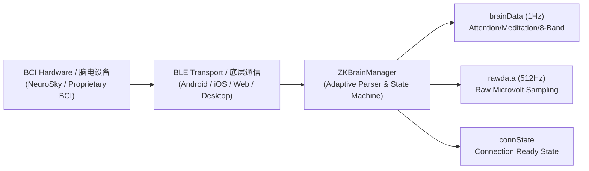

# ZKBrain SDK Official Development Expert Skill (zkbrain-sdk-dev)
# ZKBrain SDK 官方二次开发专家技能

[English Skill Guide](SKILL_EN.md) | [中文说明](SKILL.md)

This skill serves as the sole authoritative guide for application development and secondary extensions based on the **ZKBrain Cross-Platform Brain-Computer Interface (BCI) SDK**. Any AI assistant or developer writing BCI business logic must strictly comply with this skill specification to eliminate API hallucinations.
本技能为基于 **ZKBrain 脑机接口跨平台 SDK** 进行应用开发与二次扩展的唯一权威指南。任何 AI 或开发者在编写脑电业务代码时，必须严格遵守本技能规范，杜绝 API 幻觉。

---

## 1. Core Reference Contract Index / 核心参考契约索引

Before writing code, consult the following reference files according to specific requirements:
在编写代码前，请根据具体需求查阅以下参考文件：

- 📑 **API Signatures Contract / 纯接口签名契约**: [`references/api-signatures.md`](references/api-signatures.md)
  Covers all public classes, properties, Flow reactive streams, and parameter specifications in the SDK.
  收录 SDK 对外公开的类、属性、Flow 数据流与参数规范。
- ⚡ **20-Line Golden Recipes / 20 行黄金样板**: [`references/recipes.md`](references/recipes.md)
  Includes minimal closed-loop code for connection, stream listening, Compose waveform plotting, and cloud recording.
  涵盖极简连接、数据流监听、Compose 波形绘制、云端安全录制的最简闭环代码。
- 🛡️ **Gotchas & DO/DON'T Rules / 避坑与 DO/DON'T 铁律**: [`references/gotchas.md`](references/gotchas.md)
  Critical safeguards for NeuroSky hardware ignition packets, reconnection debouncing, thread dispatching, and memory leak prevention.
  重点防范 NeuroSky 硬件点火包、断连自愈防抖、后台线程调度与内存防泄漏。

---

## 2. Core Architecture Overview (30s) / 核心架构认知（30 秒速览）

ZKBrain SDK employs a unified reactive event-stream model (Kotlin Coroutines Flow / Swift AsyncSequence / Web Events):
ZKBrain SDK 采用统一的响应式事件流模型（Kotlin Coroutines Flow / Swift AsyncSequence / Web Events）：

---

## 3. Standard Development Workflow / 标准开发工作流

When fulfilling BCI requirements, follow these delivery steps:
当开发者提出脑机相关需求时，遵循以下步骤交付：

1. **Verify Data Sources / 核对数据源**:
   - **Real-time Raw Waveform / 原始波形绘制**: Consume `ZKBrainManager.rawdata` (512Hz integer microvolt samples / 512Hz 整数采样).
   - **Fatigue / Attention Dashboard / 疲劳与专注度大屏**: Consume `ZKBrainManager.brainData` (1 packet per second `MultiBrainEeg` containing `attention`, `meditation`, `delta`, `theta`, `lowAlpha`, `highAlpha`, etc.).
   - **Connection State / 连接状态**: Observe `ZKBrainManager.connState`. When state reaches `CONNECTED`, the device is fully initialized and ready.
2. **Follow Golden Recipes / 照抄黄金样板**: Always reuse established paradigms from [`references/recipes.md`](references/recipes.md). Do not invent custom connection or retry logic.
3. **Anti-Collapse & Performance Constraints / 遵循防坍塌与性能约束**:
   - When rendering 512Hz raw EEG waves, never trigger high-frequency full Recomposition. Use a RingBuffer with Canvas or off-screen rendering.
   - All runtime log outputs and UI toasts must be in pure English.
