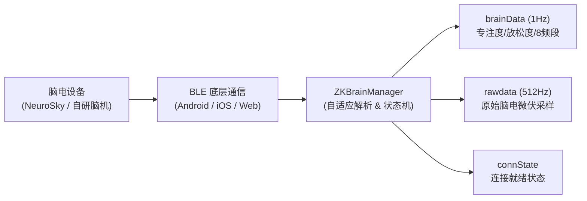

# ZKBrain SDK 官方二次开发专家技能 (zkbrain-sdk-dev)

本技能为基于 **ZKBrain 脑机接口跨平台 SDK** 进行应用开发与二次扩展的唯一权威指南。任何 AI 或开发者在编写脑电业务代码时，必须严格遵守本技能规范，杜绝 API 幻觉。

---

## 1. 核心参考契约索引

在编写代码前，请根据具体需求查阅以下参考文件：
- 📑 **纯接口签名契约**：[`references/api-signatures.md`](file:///e:/zkt_git_project/blink/project_kpm/.agents/skills/zkbrain-sdk-dev/references/api-signatures.md)
  收录 SDK 对外公开的类、属性、Flow 数据流与参数规范。
- ⚡ **20 行黄金样板**：[`references/recipes.md`](file:///e:/zkt_git_project/blink/project_kpm/.agents/skills/zkbrain-sdk-dev/references/recipes.md)
  涵盖极简连接、数据流监听、Compose 波形绘制、云端安全录制的最简闭环代码。
- 🛡️ **避坑与 DO/DON'T 铁律**：[`references/gotchas.md`](file:///e:/zkt_git_project/blink/project_kpm/.agents/skills/zkbrain-sdk-dev/references/gotchas.md)
  重点防范 NeuroSky 硬件点火包、断连自愈防抖、后台线程调度与内存防泄漏。

---

## 2. 核心架构认知（30 秒速览）

ZKBrain SDK 采用统一的响应式事件流模型（Kotlin Coroutines Flow / Swift AsyncSequence）：

---

## 3. 标准开发工作流

当开发者提出脑机相关需求时，遵循以下步骤交付：
1. **核对数据源**：
   - 原始脑电波形绘制：消费 `ZKBrainManager.rawdata` (512Hz 整数采样)；
   - 疲劳/专注度大屏：消费 `ZKBrainManager.brainData` (每秒 1 包 `MultiBrainEeg`，包含 `attention`, `meditation`, `delta`, `theta`, `lowAlpha`, `highAlpha` 等)；
   - 连接状态：监听 `ZKBrainManager.connState`，状态为 `CONNECTED` 时即代表设备完全就绪。
2. **照抄黄金样板**：优先复用 [`references/recipes.md`](file:///e:/zkt_git_project/blink/project_kpm/.agents/skills/zkbrain-sdk-dev/references/recipes.md) 中的黄金范式，禁止自行发明监听或重连逻辑。
3. **遵循防坍塌与性能约束**：绘制 512Hz 原始波时，严禁使用高频全量 Recomposition，必须使用 RingBuffer 或 Canvas 离屏缓冲。
