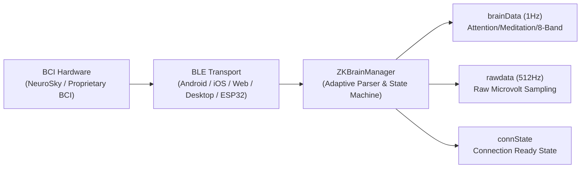

# ZKBrain SDK Official Development Expert Skill (zkbrain-sdk-dev)

[English](SKILL_EN.md) | [中文](SKILL.md)

This skill serves as the sole authoritative guide for application development and secondary extensions based on the **ZKBrain Cross-Platform Brain-Computer Interface (BCI) SDK**. Any AI assistant or developer writing BCI business logic must strictly comply with this skill specification to eliminate API hallucinations.

---

## 1. Core Reference Contract Index

Before writing code, consult the following reference files according to specific requirements:

- 📑 **API Signatures Contract**: [`references/api-signatures-en.md`](references/api-signatures-en.md) (Bilingual: [`references/api-signatures.md`](references/api-signatures.md))  
  Covers all public classes, properties, Flow reactive streams, and parameter specifications in the SDK.
- ⚡ **20-Line Golden Recipes**: [`references/recipes-en.md`](references/recipes-en.md) (Bilingual: [`references/recipes.md`](references/recipes.md))  
  Includes minimal closed-loop code for connection, stream listening, Compose waveform plotting, and cloud recording.
- 🛡️ **Gotchas & DO/DON'T Rules**: [`references/gotchas-en.md`](references/gotchas-en.md) (Bilingual: [`references/gotchas.md`](references/gotchas.md))  
  Critical safeguards for NeuroSky hardware ignition packets, reconnection debouncing, thread dispatching, and memory leak prevention.

---

## 2. Core Architecture Overview (30s)

ZKBrain SDK employs a unified reactive event-stream model (Kotlin Coroutines Flow / Swift AsyncSequence / Web Events / Embedded C++ Stream):

---

## 3. Standard Development Workflow

When fulfilling BCI requirements, follow these delivery steps:

1. **Verify Data Sources**:
   - **Real-time Raw Waveform**: Consume `ZKBrainManager.rawdata` (512Hz integer microvolt samples).
   - **Fatigue / Attention Dashboard**: Consume `ZKBrainManager.brainData` (1 packet per second `MultiBrainEeg` containing `attention`, `meditation`, `delta`, `theta`, `lowAlpha`, `highAlpha`, etc.).
   - **Connection State**: Observe `ZKBrainManager.connState`. When state reaches `CONNECTED`, the device is fully initialized and ready.
2. **Follow Golden Recipes**: Always reuse established paradigms from [`references/recipes-en.md`](references/recipes-en.md). Do not invent custom connection or retry logic.
3. **Anti-Collapse & Performance Constraints**:
   - When rendering 512Hz raw EEG waves, never trigger high-frequency full Recomposition. Use a RingBuffer with Canvas or off-screen rendering.
   - All runtime log outputs and UI toasts must be in pure English.
