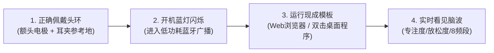
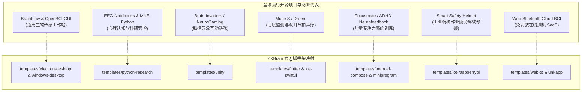

# ZKBrain Starter Kit (跨平台脑机接口开源开发套件)

[English](README_EN.md) | [中文](README.md)

> 🧠 **开箱即用的多端脑机接口 (BCI) 工程脚手架** | 覆盖 14 大主流生态、1:1 官方工业级控制台、零配置极速体验与前沿商业级产品蓝图。

**ZKBrain Starter Kit** 是基于 **ZKBrain 脑机接口跨平台核心 SDK** 构建的官方全栈模板库。无论您是**零编程基础的脑机探索者**，还是正在进行商业化落地的**资深软硬件工程师**，本套件均提供现成可运行的代码工程、完备的硬件通信状态机、标准的 4x3 三色全波段数据看板（`DeviceShowTable`），以及对标国际前沿脑机项目的成熟落地范式。

---

## 目录索引

- [🌟 一、零基础快速上手：从拆箱到看见第一条脑电波](#-一零基础快速上手从拆箱到看见第一条脑电波)
  - [1. 脑机接口 (BCI) 核心原理与生理指标大白话](#1-脑机接口-bci-核心原理与生理指标大白话)
  - [2. 零代码基础极速运行体验（免配置开发环境）](#2-零代码基础极速运行体验免配置开发环境)
  - [3. 初学者正确佩戴与硬件避坑清单](#3-初学者正确佩戴与硬件避坑清单)
- [🚀 二、市面上流行 GitHub 脑机项目对照与商业化蓝图](#-二市面上流行-github-脑机项目对照与商业化蓝图)
  - [1. BrainFlow & OpenBCI GUI 模式 ➔ 跨平台专业脑电分析工作站](#1-brainflow--openbci-gui-模式--跨平台专业脑电分析工作站)
  - [2. EEG-Notebooks & MNE-Python 模式 ➔ 认知心理学科研与实验平台](#2-eeg-notebooks--mne-python-模式--认知心理学科研与实验平台)
  - [3. Brain-Invaders & NeuroGaming 模式 ➔ 脑控念力游戏与 XR 空间交互](#3-brain-invaders--neurogaming-模式--脑控念力游戏与-xr-空间交互)
  - [4. Muse S / Dreem 模式 ➔ 睡眠周期分期与脑波声疗助眠系统](#4-muse-s--dreem-模式--睡眠周期分期与脑波声疗助眠系统)
  - [5. ADHD 儿童感统训练 & 考研考公高效专注番茄钟](#5-adhd-儿童感统训练--考研考公高效专注番茄钟)
  - [6. 工业智能安全帽 & 车载特种作业疲劳驾驶边缘预警网关](#6-工业智能安全帽--车载特种作业疲劳驾驶边缘预警网关)
  - [7. Web-Bluetooth 网页免驱直连与科技馆交互云展厅](#7-web-bluetooth-网页免驱直连与科技馆交互云展厅)
- [📂 三、14 大官方脚手架工程全景矩阵](#-三14-大官方脚手架工程全景矩阵)
  - [1. 移动端原生开发 (Mobile Native)](#1-移动端原生开发-mobile-native)
  - [2. 跨平台与轻应用 (Cross-Platform & MiniProgram)](#2-跨平台与轻应用-cross-platform--miniprogram)
  - [3. 专业桌面端开发 (Desktop Workstation)](#3-专业桌面端开发-desktop-workstation)
  - [4. 游戏、XR、科研算法与 AIoT 边缘计算](#4-游戏xr科研算法与-aiot-边缘计算)
- [🛠️ 四、系统架构与工业级核心规范](#️-四系统架构与工业级核心规范)
  - [1. 硬件协议自动分流 (ZKTeco ASCII vs NeuroSky 20B XMW)](#1-硬件协议自动分流-zkteco-ascii-vs-neurosky-20b-xmw)
  - [2. 1:1 标准 UI 与 4x3 三色数据表规范](#2-11-标准-ui-与-4x3-三色数据表规范)
  - [3. 全平台 100% 纯英文运行时日志规范](#3-全平台-100-纯英文运行时日志规范)
- [📚 五、开发者资源与开源授权](#-五开发者资源与开源授权)

---

## 🌟 一、零基础快速上手：从拆箱到看见第一条脑电波

对于从未接触过脑机接口或没有任何编程经验的用户，您不需要了解汇编、C++ 指针或复杂的蓝牙底层通信，按照以下步骤即可在 3 分钟内看到自己大脑跳动的真实电信号。

### 1. 脑机接口 (BCI) 核心原理与生理指标大白话

- **人脑是如何发出信号的？**
  人的大脑在思考、走神、焦虑或睡觉时，数十亿个神经元会产生微弱的生物电流（仅数微伏 $\mu\text{V}$，相当于普通五号干电池的百万分之一）。ZKBrain 脑电设备通过贴在额头处的干电极感应这种微电信号，并以耳垂作为人体零电位参考点，放大滤波后通过蓝牙传输出来。

- **常见 12 项脑电指标白话对照表**：
  | 指标名称 | 取值范围 | 白话解释 | 真实日常场景示例 |
  | :--- | :---: | :--- | :--- |
  | **信号质量 (Signal Quality)** | `0 ~ 200` | **电极接触好不好**：`0` 代表接触良好、数据极度可信；`200` 代表完全脱落或没戴好。 | 戴好头环后数值降为 0，摘下头环瞬间变为 200。 |
  | **专注度 (Attention)** | `0 ~ 100` | **注意力集中程度**：数值越高代表大脑越聚焦、目标感越强。 | 正在做复杂的算术题、阅读专业论文（数值通常 70~95）。 |
  | **放松度 (Meditation)** | `0 ~ 100` | **身心平静程度**：数值越高代表大脑越放松、无杂念。 | 闭上眼睛深呼吸、放空大脑、冥想（数值通常 70~90）。 |
  | **Delta 波 (0.5~2.75Hz)** | 能量值 | **深度睡眠波**：通常在无意识、深睡状态下大幅增加。 | 婴儿时期或成年人无梦的熟睡期。 |
  | **Theta 波 (3.5~6.75Hz)** | 能量值 | **潜意识与走神波**：介于清醒与睡眠之间，与白日梦、灵感、疲倦相关。 | 上午开会犯困打瞌睡、刚睡醒还没回过神。 |
  | **Low/High Alpha 波 (7.5~11.75Hz)** | 能量值 | **心流与安宁波**：清醒但非常平静的状态，闭眼即明显上升。 | 听舒缓轻音乐、瑜伽冥想、高手做熟悉的熟练工作。 |
  | **Low/High Beta 波 (13~29.75Hz)** | 能量值 | **敏捷思考与警觉波**：大脑处于积极处理任务、逻辑计算或焦虑应激。 | 面对突发工作紧急救火、高难度电子竞技操作。 |
  | **Gamma 波 (31~49.75Hz)** | 能量值 | **多感官高阶整合波**：信息加工的高峰期，与瞬间洞察、记忆唤醒相关。 | 突然灵光一闪想通难题、多视角同时观察判断。 |
  | **MEMS 6 轴姿态 (Euler/Quat)** | 角度/四元数 | **头部的真实物理空间姿态**：横滚 (Roll)、俯仰 (Pitch)、偏航 (Yaw)。 | 记录是否在点头打瞌睡、低头看手机或左右晃脑。 |

---

### 2. 零代码基础极速运行体验（免配置开发环境）

不需要安装庞大的 IDE 或搭建复杂的开发依赖，任意普通电脑都可以直接体验：

#### 方案 A：Web 浏览器秒级体验（无需安装任何软件）
1. 使用电脑或安卓手机自带的 **Google Chrome** 或 **Microsoft Edge** 浏览器；
2. 打开 [`templates/web-ts/index.html`](templates/web-ts/index.html)（或通过轻量静态服务器访问）；
3. 确保电脑蓝牙开启，点击页面上的 **“🔍 搜索设备 (Search Devices)”**；
4. 浏览器会弹出系统蓝牙选择窗口，点击您的脑电头环（如 `ZKBrain-PRO-8801` 或 `MindWave Mobile`）并点击“配对”；
5. 3 秒内，页面上的 4x3 三色数据表与脑电跳动曲线将实时点亮！

#### 方案 B：Windows 桌面双击即运行（自带 Python 即可）
1. 在 Windows 电脑中进入目录：[`templates/windows-desktop/python/`](templates/windows-desktop/python/)；
2. 直接双击运行 `gui_demo.py`（若未关联，在终端输入 `python gui_demo.py`）；
3. 弹出官方 1:1 独立桌面控制台，支持设备搜索、连接断开、指令调试与全频段频谱观测。

#### 方案 C：微信小程序即扫即用
1. 使用微信开发者工具导入 [`templates/miniprogram/`](templates/miniprogram/)；
2. 点击真机预览，用微信扫码即可在手机上体验无缝蓝牙连接与专注力实时大屏。

---

### 3. 初学者正确佩戴与硬件避坑清单

1. **电极接触清洁**：
   - 额头处如果有油脂或汗水，容易造成接触不良（信号质量呈现 50~200 的噪点）。佩戴前建议用纸巾或酒精棉片擦拭额头传感器触点位置。
2. **耳夹参考电极至关重要**：
   - 必须将金属耳夹牢固夹在**左耳或右耳耳垂处**。耳垂为人体基准电位，若耳夹脱落，脑电信号将变为纯空气电磁噪声。
3. **硬件秒关秒开“电容未放电死锁”警示**：
   - 类似 NeuroSky MindWave 等硬件采用物理滑动开关。关机时，头环内部电路电容需要 **2~3 秒完全放电**；
   - 若关机后立即（1 秒内）重新打开，蓝牙芯片容易处于半复位的死锁假死状态，导致电脑或手机搜不到蓝牙；
   - **正确做法**：关机后心里默数“1、2、3”，然后再开机，指示灯恢复有节奏的蓝灯闪烁即可秒级建连。

---

## 🚀 二、市面上流行 GitHub 脑机项目对照与商业化蓝图

脑机接口（BCI）在 GitHub 上拥有活跃的开源社区。许多开发者希望复刻经典产品或打造创新的消费级脑电应用。以下列出全球最流行、商业化最成功的脑机产品形态，并阐明如何直接基于 ZKBrain 现成模板进行 1:1 落地：

### 1. BrainFlow & OpenBCI GUI 模式 ➔ 跨平台专业脑电分析工作站
- **开源标杆**：`brainflow-dev/brainflow` (2k+ 🌟), `OpenBCI/OpenBCI_GUI`
- **产品核心功能**：
  多通道信号采集、512Hz 原始波形平滑滤波、8 频段功率谱密度条形图、实时频域变换（FFT/Welch）、设备电量与阻抗检测。
- **推荐对应脚手架**：[`templates/electron-desktop/`](templates/electron-desktop/) 或 [`templates/windows-desktop/`](templates/windows-desktop/)
- **工程落地蓝图**：
  - 基于 Electron + Web Bluetooth 技术栈，支持一套代码一键交叉编译为 Windows (`.exe`)、macOS (`.dmg`) 与 Linux (`.deb`) 独立安装包；
  - 模板已内置完整的 4x3 三色全波段数据表（`DeviceShowTable`），粉色专注/放松、青色慢波与 Alpha、黄色高频 Beta/Gamma 严格对齐，支持 512Hz 高速 Canvas 离屏缓冲绘制。

### 2. EEG-Notebooks & MNE-Python 模式 ➔ 认知心理学科研与实验平台
- **开源标杆**：`NeuroTechX/eeg-notebooks` (1.5k+ 🌟), `mne-tools/mne-python`
- **产品核心功能**：
  认知心理学实验（视觉/听觉诱发电位 ERP、P300 实验、N200 靶刺激识别）、基线校准、时序事件打标、国际标准 EDF+ 脑电数据集打包。
- **推荐对应脚手架**：[`templates/python-research/`](templates/python-research/)
- **工程落地蓝图**：
  - 模板内置交互式 Jupyter Notebook（`zkbrain_eeg_analysis.ipynb`）与独立科研 GUI 工作站（`research_gui.py`）；
  - 内置 0.5~50Hz 带通滤波 + 50Hz 工频陷波处理流程；
  - 提供**一键导出欧洲数据格式 (EDF+)** 脑电数据集功能，以及包含每秒时序事件的 `events.csv` 与 `meta.json`，可直接供 EEGLAB、MNE、Matlab 读取分析。

### 3. Brain-Invaders & NeuroGaming 模式 ➔ 脑控念力游戏与 XR 空间交互
- **开源标杆**：`bcipipeline_cs/brain-invaders`, Unity OpenBCI VR
- **产品核心功能**：
  意念施法（专注度越高伤害越高/物体悬浮越高）、心理状态自适应难度调整（当玩家紧张/焦虑时敌人变强）、VR/XR 空间计算眼动与脑电多模态融合。
- **推荐对应脚手架**：[`templates/unity/`](templates/unity/)
- **工程落地蓝图**：
  - 模板内置现成的 **“脑控念力悬浮小球 (Force Levitation)”** 演示场景；
  - 核心脚本 `ForceLevitationController.cs` 示范了如何将平滑后的 `Attention` 数值实时映射为 Unity 物理刚体（Rigidbody）的垂直向浮力；
  - 支持直接构建部署到 PC、Android、iOS，或主流 XR 头显（Meta Quest 3、Pico 4、Apple Vision Pro）。

### 4. Muse S / Dreem 模式 ➔ 睡眠周期分期与脑波声疗助眠系统
- **商业代表**：Muse S (InteraXon), Dreem 3 睡眠头带
- **产品核心功能**：
  整夜睡眠追踪、快速眼动期 (REM)/深睡/浅睡自动分期、根据脑电 Alpha/Theta 波强弱实时改变耳机中的白噪音、雨声或双耳节拍 (Binaural Beats)，引导大脑快速进入睡眠状态。
- **推荐对应脚手架**：[`templates/flutter/`](templates/flutter/) 或 [`templates/ios-swiftui/`](templates/ios-swiftui/)
- **工程落地蓝图**：
  - 利用 Flutter 或 Swift 原生后台蓝牙采集保活机制，整夜持续监听 1Hz 综合指标；
  - 实时计算 Theta 与 Delta 能量比值，当检测到入睡时自动渐弱音频音量；
  - 生成整夜睡眠质量柱状图与疲劳恢复评分。

### 5. ADHD 儿童感统训练 & 考研考公高效专注番茄钟
- **产品核心功能**：
  神经反馈训练（Neurofeedback）：用户在专注阅读时保持舒缓背景音，一旦走神（Attention 跌破 40）立即触发温和蜂鸣提醒；每坚持专注 25 分钟奖励勋章并生成脑电热力图。
- **推荐对应脚手架**：[`templates/android-compose/`](templates/android-compose/) 或 [`templates/miniprogram/`](templates/miniprogram/)
- **工程落地蓝图**：
  - 采用现代声明式 Jetpack Compose 或微信小程序架构；
  - 结合手机本地轻量数据库存储每日训练历史，方便家长或学员自身直观对比注意力曲线演进。

### 6. 工业智能安全帽 & 车载特种作业疲劳驾驶边缘预警网关
- **产品核心功能**：
  在矿山、重型工程车辆、长途货运或高空作业场景中，通过头带实时监测操作人员疲劳度。当综合疲劳指数超标时，边缘主机毫秒级触发蜂鸣器高分贝警报并上传云端安防系统。
- **推荐对应脚手架**：[`templates/iot-raspberrypi/`](templates/iot-raspberrypi/)
- **工程落地蓝图**：
  - 纯 Python 编写的 Linux systemd 守护进程（`daemon_fatigue_alert.py`），支持开机自启与静默看门狗重连；
  - 内置树莓派物理引脚控制（`RPi.GPIO` Pin 18），超限时直接拉高电平触发实体蜂鸣器/爆闪灯；
  - 内置轻量局域网 Web 监控大屏（`edge_web_dashboard.py`），工控平板或手机在同一局域网下输入 `http://<树莓派IP>:8080` 即可实时查看全员状态。

### 7. Web-Bluetooth 网页免驱直连与科技馆交互云展厅
- **产品核心功能**：
  在科技馆、高校开放日或企业展厅中，参观者只需打开网页就能戴上头带互动，免去排队下载安装客户端的繁琐流程。
- **推荐对应脚手架**：[`templates/web-ts/`](templates/web-ts/) 或 [`templates/uni-app/`](templates/uni-app/)
- **工程落地蓝图**：
  - 基于 W3C 标准 Web Bluetooth API，纯前端 TypeScript 实现，零服务端驱动；
  - 结合 Three.js 或 Canvas 可快速拓展三维大脑神经元粒子流互动。

---

## 📂 三、14 大官方脚手架工程全景矩阵

全工程严格收敛在 `templates/` 目录下，所有模板均已通过编译验证与真机联调：

### 1. 移动端原生开发 (Mobile Native)
| 平台 / 技术栈 | 模板目录 | 运行方式 | 核心特性 |
| :--- | :--- | :--- | :--- |
| **Android Compose (官方主推)** | [`templates/android-compose/`](templates/android-compose/) | Android Studio 打开，执行 `./gradlew assembleDebug` | 现代 Jetpack Compose 声明式大屏，Maven Central (`1.2.1`) 极速依赖，完整动态权限申请 |
| **Android Native (经典原生)** | [`templates/android-native/`](templates/android-native/) | Android Studio 打开运行 | 经典 XML + ViewBinding 架构，轻量简洁，内置指令发送与终端监控 |
| **华为鸿蒙 (HarmonyOS Next)** | [`templates/harmonyos/`](templates/harmonyos/) | DevEco Studio 打开运行 | ArkTS 声明式语法，Stage 模型，系统级低功耗蓝牙扫描与三色数据看板 |
| **原生 iOS (SwiftUI)** | [`templates/ios-swiftui/`](templates/ios-swiftui/) | Xcode 打开 `Package.swift` | 现代 SwiftUI 架构，原生 `async/await` 消费脑电数据流，6 轴姿态实时渲染 |

### 2. 跨平台与轻应用 (Cross-Platform & MiniProgram)
| 平台 / 技术栈 | 模板目录 | 运行方式 | 核心特性 |
| :--- | :--- | :--- | :--- |
| **Flutter 跨平台** | [`templates/flutter/`](templates/flutter/) | `flutter run` | Dart 跨 Android / iOS 双端，`flutter_blue_plus` 响应式流，1:1 克隆完整控制台 |
| **Uni-app (Vue 3 + TS)** | [`templates/uni-app/`](templates/uni-app/) | `npm run dev:mp-weixin` | **一套代码发布 10+ 平台**：同时支持微信/支付宝/抖音小程序及 iOS/Android App |
| **React Native (TS)** | [`templates/react-native/`](templates/react-native/) | `npm start` | 国际化主流跨端方案，`react-native-ble-plx` 物理层驱动，动态权限与控制台完备 |
| **微信小程序** | [`templates/miniprogram/`](templates/miniprogram/) | 微信开发者工具导入 | 原生小程序架构，引入官方 SDK，内置蓝牙搜索、连接弹窗与 4x3 三色大屏 |
| **Web 浏览器 (H5)** | [`templates/web-ts/`](templates/web-ts/) | `npm install && npm run dev` | Vite + TypeScript，基于 W3C Web Bluetooth 直连，免驱动在 Chrome/Edge 中秒开 |

### 3. 专业桌面端开发 (Desktop Workstation)
| 平台 / 技术栈 | 模板目录 | 运行方式 | 核心特性 |
| :--- | :--- | :--- | :--- |
| **Electron 跨平台桌面端** | [`templates/electron-desktop/`](templates/electron-desktop/) | `npm install && npm start` | 一键打包 Windows (`.exe`)、macOS (`.dmg`) 与 Linux (`.deb`) 商业分析大屏 |
| **Windows 桌面端 (C#/Python)** | [`templates/windows-desktop/`](templates/windows-desktop/) | 双击 `python/gui_demo.py` 或 Visual Studio 编译 C# | 原生 Windows BLE/串口驱动，内置独立 Python Tkinter 可视化大屏与 C# WinUI 工程 |

### 4. 游戏、XR、科研算法与 AIoT 边缘计算
| 平台 / 技术栈 | 模板目录 | 运行方式 | 核心特性 |
| :--- | :--- | :--- | :--- |
| **Unity 3D / XR 脑控** | [`templates/unity/`](templates/unity/) | Unity 2021+ 导入打开场景 | **意念悬浮小球场景**：专注度越高小球悬浮越高，支持 Meta Quest / Pico / Vision Pro |
| **Python 科研算法工作站** | [`templates/python-research/`](templates/python-research/) | `python research_gui.py` 或启动 Jupyter | 0.5-50Hz 带通滤波、Welch PSD 功率谱估计，一键导出国际标准 **EDF+** 与 CSV 数据集 |
| **树莓派 / Linux IoT 边缘网关** | [`templates/iot-raspberrypi/`](templates/iot-raspberrypi/) | `python daemon_fatigue_alert.py` | 工业边缘守护进程，疲劳超限触发硬件 GPIO 引脚 18 蜂鸣器报警，带局域网 Web 看板 |

---

## 🛠️ 四、系统架构与工业级核心规范

### 1. 硬件协议自动分流 (ZKTeco ASCII vs NeuroSky 20B XMW)

SDK 底层内置智能硬件路由器，开发者无需手动关心分包与粘包：
1. **NeuroSky MindWave 系列 (XMW 二进制协议)**：
   - 设备建连后**不会主动输出数据**；
   - SDK 在物理链路接通后，自动向写入特征下发 20 字节点火序列：`0x15` (开启 512Hz Raw) 与 `0x17` (开启 8 频段)；
   - 支持下发工频陷波滤波（`0x1B` 50Hz / `0x1C` 60Hz）、读取电量（`0x06`）与读写设备 SN（`0xF4`/`0xF2`）。
2. **ZKTeco 自研脑电设备 (ASCII 协议)**：
   - 握手后自动透传数据流，支持纯文本控制指令（如 `mems_on:1;` 开启 6 轴空间姿态、`eeg_data_rate:512;` 切换采样率、`battery:?;` 查电量）。

### 2. 1:1 标准 UI 与 4x3 三色数据表规范

全套 14 个模板在界面设计上 100% 保持一致，均包含以下 7 大核心功能板块：
- **板块 1：顶部操作栏** ➔ 包含设备搜索弹窗按钮、OTA/DFU 固件检测通道与授权徽章；
- **板块 2：统一设备连接状态卡片** ➔ 状态指示圆点、设备名称、电量胶囊、3 个技术特性 Badges、MAC/SN 序列号展示与断开/重连主按钮；
- **板块 3：Channel Settings 通道配置** ➔ Left (FP1) 单通道使能开关；
- **板块 4：Chart Display Settings 图表显隐矩阵** ➔ 12 项生理指标独立显隐过滤；
- **板块 5：NeuroSky / MindWave 专属协议控制台** ➔ 20 字节二进制点火、50/60Hz 陷波、读电量、查写 SN 按钮组；
- **板块 6：ZKBrain 自研脑电控制台与 MEMS 姿态卡片** ➔ 姿态欧拉角 (Euler) 与四元数 (Quaternion) 实时演算、采样率切换与指令输入框；
- **板块 7：4x3 三色全波段数据表 (DeviceShowTable)** ➔ 居中 MAC 地址黑底条，严格分为：
  - **粉色背景 (`#FFE4E1`)**：Attention、Meditation、Signal Quality、Raw EEG（认知与原始信号）；
  - **青色背景 (`#E0FFFF`)**：Delta、Theta、Low Alpha、High Alpha（慢波与清醒节律）；
  - **黄色背景 (`#F0E68C`)**：Low Beta、High Beta、Low Gamma、Mid Gamma（思考与高阶感知）。

### 3. 全平台 100% 纯英文运行时日志规范

为确保跨端系统在专业生产环境下的严谨性与整洁度，所有模板工程的运行时日志、控制台回显、Toast 提示及终端打印均严格遵循 **100% 纯英文规范 (Pure English Runtime Outputs)**：
- `[System] ZKBrain <Platform> console initialized successfully.`
- `[BLE] Scanning for nearby BLE BCI devices...`
- `[BLE] Connected successfully to: <DeviceName> (<MAC>)`
- `[TX >> XMW] Ignition start packet: 0x15 (Raw) + 0x17 (Band)`
- `[Channel] Left (FP1): true`
- `[DFU] OTA firmware check: Already on latest stable release v2.4.0`

---

## 📚 五、开发者资源与开源授权

- **Maven Central 依赖坐标 (Android)**：`io.github.zkteco-xteam:zkbrain-android:1.2.1`
- **纯契约接口签名速查**：[`.agents/skills/zkbrain-sdk-dev/references/api-signatures.md`](.agents/skills/zkbrain-sdk-dev/references/api-signatures.md)
- **20 行黄金代码样板**：[`.agents/skills/zkbrain-sdk-dev/references/recipes.md`](.agents/skills/zkbrain-sdk-dev/references/recipes.md)
- **跨端避坑与 DO/DON'T 铁律**：[`.agents/skills/zkbrain-sdk-dev/references/gotchas.md`](.agents/skills/zkbrain-sdk-dev/references/gotchas.md)
- **硬件指令与协议集成规范**：[`docs/ZKBrain_设备指令下发与硬件协议集成指南.md`](docs/ZKBrain_设备指令下发与硬件协议集成指南.md)

### 开源许可 (License)
- 本 Starter Kit 脚手架工程遵循 **MIT License** 开源，开发者可自由修改、集成与商业化分发；
- `zkbrain` 跨平台核心 SDK 由 **熵基科技脑机事业部 (ZKTeco Brain-Computer Interface Division)** 提供技术支持。
