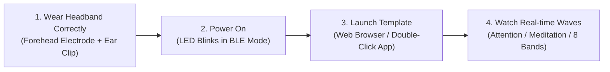
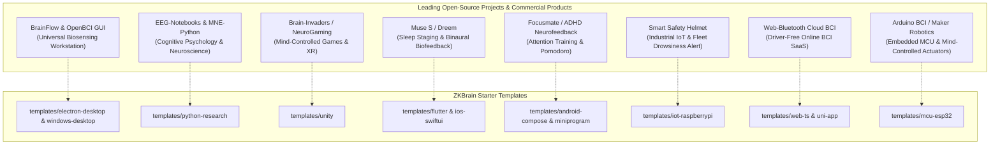

# ZKBrain Starter Kit (Cross-Platform Brain-Computer Interface Kit)

[English](README_EN.md) | [中文](README.md)

> 🧠 **Production-Grade Cross-Platform BCI Application Starter Kit** | Covering 15 major software ecosystems, 1:1 industrial device management console, zero-configuration beginner walkthrough, and commercial product blueprints.

**ZKBrain Starter Kit** is the official open-source starter suite built upon the **ZKBrain Cross-Platform BCI Core SDK**. Whether you are an **absolute beginner with zero programming experience** or a **senior engineer building commercial neurotechnology products**, this suite provides ready-to-run codebases, comprehensive hardware state machines, standardized 4x3 tri-color brainwave dashboards (`DeviceShowTable`), and established blueprints modeled after leading international open-source BCI projects.

---

## Table of Contents

- [🌟 1. Beginner Quickstart: From Unboxing to Your First Brainwave](#-1-beginner-quickstart-from-unboxing-to-your-first-brainwave)
  - [1.1 BCI Core Principles & Brainwave Metrics in Plain English](#11-bci-core-principles--brainwave-metrics-in-plain-english)
  - [1.2 Zero-Code Quick-Run Experiences (No Environment Setup Needed)](#12-zero-code-quick-run-experiences-no-environment-setup-needed)
  - [1.3 Wearing Guidelines & Hardware Pitfall Checklist](#13-wearing-guidelines--hardware-pitfall-checklist)
- [🚀 2. Trending GitHub BCI Projects Comparison & Commercial Blueprints](#-2-trending-github-bci-projects-comparison--commercial-blueprints)
  - [2.1 BrainFlow & OpenBCI GUI Model ➔ Professional BCI Analysis Workstation](#21-brainflow--openbci-gui-model--professional-bci-analysis-workstation)
  - [2.2 EEG-Notebooks & MNE-Python Model ➔ Cognitive Neuroscience & Research Workstation](#22-eeg-notebooks--mne-python-model--cognitive-neuroscience--research-workstation)
  - [2.3 Brain-Invaders & NeuroGaming Model ➔ Mind-Controlled Gaming & XR Computing](#23-brain-invaders--neurogaming-model--mind-controlled-gaming--xr-computing)
  - [2.4 Muse S / Dreem Model ➔ Sleep Staging & Auditory Biofeedback](#24-muse-s--dreem-model--sleep-staging--auditory-biofeedback)
  - [2.5 ADHD Attention Training & Neurofeedback Focus Pomodoro](#25-adhd-attention-training--neurofeedback-focus-pomodoro)
  - [2.6 Smart Industrial Safety Helmet & Fleet Driver Fatigue Edge Gateway](#26-smart-industrial-safety-helmet--fleet-driver-fatigue-edge-gateway)
  - [2.7 Web-Bluetooth Browser Driver-Free Cloud BCI & Interactive Showroom](#27-web-bluetooth-browser-driver-free-cloud-bci--interactive-showroom)
- [📂 3. The 15 Production-Grade Templates Matrix](#-3-the-15-production-grade-templates-matrix)
  - [3.1 Mobile Native](#31-mobile-native)
  - [3.2 Cross-Platform & MiniProgram](#32-cross-platform--miniprogram)
  - [3.3 Desktop Workstation](#33-desktop-workstation)
  - [3.4 Gaming, XR, Scientific Research & AIoT Edge Computing](#34-gaming-xr-scientific-research--aiot-edge-computing)
- [🛠️ 4. System Architecture & Industrial Engineering Standards](#️-4-system-architecture--industrial-engineering-standards)
  - [4.1 Automatic Hardware Protocol Routing (ZKTeco ASCII vs NeuroSky 20B XMW)](#41-automatic-hardware-protocol-routing-zkteco-ascii-vs-neurosky-20b-xmw)
  - [4.2 1:1 Standard UI & 4x3 Tri-Color Data Table Specifications](#42-11-standard-ui--4x3-tri-color-data-table-specifications)
  - [4.3 100% Pure English Runtime Logs Standard](#43-100-pure-english-runtime-logs-standard)
- [📚 5. Developer Resources & Open-Source Licensing](#-5-developer-resources--open-source-licensing)

---

## 🌟 1. Beginner Quickstart: From Unboxing to Your First Brainwave

For users with no prior experience with brain-computer interfaces or programming, you do not need to understand assembly, C++ pointers, or low-level Bluetooth protocol stacks. Follow the steps below to observe your brain's real electrical signals within 3 minutes.

### 1.1 BCI Core Principles & Brainwave Metrics in Plain English

- **How does the human brain emit electrical signals?**
  When thinking, daydreaming, relaxing, or sleeping, billions of neurons in the brain fire synchronistic action potentials, generating microvolt-level ($\mu\text{V}$) bioelectrical signals (about one-millionth the voltage of a 1.5V AA battery). ZKBrain headbands pick up these subtle microvolt signals via forehead dry electrodes, using the earlobe as an electrical ground reference. After hardware amplification and filtering, the digitized data is transmitted via Bluetooth Low Energy (BLE).

- **12 Core Brainwave Metrics Plain-English Glossary**:
  | Metric Name | Value Range | Plain-English Explanation | Real-Life Scenario Example |
  | :--- | :---: | :--- | :--- |
  | **Signal Quality** | `0 ~ 200` | **Electrode Contact Quality**: `0` means excellent skin contact and high data fidelity; `200` means completely detached or poor contact. | Drops to `0` when properly worn, jumps to `200` immediately upon taking off the headband. |
  | **Attention** | `0 ~ 100` | **Mental Focus Level**: Higher values indicate higher cognitive focus and goal-directed mental processing. | Solving a math puzzle or reading a technical specification (typically 70~95). |
  | **Meditation** | `0 ~ 100` | **Mental Calmness Level**: Higher values indicate psychological relaxation, calm breathing, and absence of mental chatter. | Closed-eye breathing exercises, mindfulness, or listening to calm music (typically 70~90). |
  | **Delta Band (0.5~2.75Hz)** | Power value | **Deep Sleep Wave**: Predominant during dreamless, restorative deep sleep. | Adult non-REM slow-wave sleep. |
  | **Theta Band (3.5~6.75Hz)** | Power value | **Subconscious & Drowsiness Wave**: Between wakefulness and sleep; tied to daydreams, intuition, and drowsiness. | Nodding off during a boring morning meeting or waking up half-conscious. |
  | **Low/High Alpha (7.5~11.75Hz)** | Power value | **Flow & Calmness Wave**: Relaxed alertness; rises sharply whenever the eyes are closed. | Flow state while doing familiar craftsmanship or meditating peacefully. |
  | **Low/High Beta (13~29.75Hz)** | Power value | **Active Thinking & Alertness Wave**: Active cognitive tasks, logical calculation, or acute stress. | Emergency work troubleshooting, esports tournaments. |
  | **Gamma Band (31~49.75Hz)** | Power value | **High-Order Cognitive Integration Wave**: Peak cognitive processing, rapid association, and multisensory binding. | An "aha!" moment when solving a difficult riddle. |
  | **MEMS 6-Axis Posture (Euler/Quat)** | Angles/Quat | **Real-world physical head orientation**: Roll, Pitch, Yaw. | Detecting head drooping from drowsiness, nodding, or looking down at phones. |

---

### 1.2 Zero-Code Quick-Run Experiences (No Environment Setup Needed)

No bulky IDEs, SDK compilations, or complex toolchains required:

#### Option A: Web Browser 3-Second Experience (Zero Installation)
1. Launch **Google Chrome** or **Microsoft Edge** on your PC, Mac, or Android device;
2. Open [`templates/web-ts/index.html`](templates/web-ts/index.html) (or serve it via any simple local static web server);
3. Ensure Bluetooth is enabled, and click **"🔍 Search Devices"**;
4. Select your BCI headband (e.g. `ZKBrain-PRO-8801` or `MindWave Mobile`) in the browser pop-up and click "Pair";
5. Within 3 seconds, the 4x3 tri-color data table and dynamic EEG waveform line chart will start streaming live!

#### Option B: Windows Desktop One-Click GUI (Runs on Default Python)
1. On your Windows machine, open the folder: [`templates/windows-desktop/python/`](templates/windows-desktop/python/);
2. Double-click `gui_demo.py` (or run `python gui_demo.py` in terminal);
3. An official 1:1 desktop dashboard will open immediately, offering device scanning, live telemetry, and frequency spectrum visualization.

#### Option C: WeChat MiniProgram Instant QR Scan
1. Import [`templates/miniprogram/`](templates/miniprogram/) into the WeChat DevTools;
2. Click Preview and scan the QR code on your mobile phone to experience instant BLE connectivity and attention dashboards.

---

### 1.3 Wearing Guidelines & Hardware Pitfall Checklist

1. **Electrode Skin Contact**:
   - Sweat or skin oil on the forehead can cause impedance noise (signal quality reading 50~200). Wipe the forehead skin and sensor contact pads before wearing.
2. **The Ear Clip Reference Electrode is Mandatory**:
   - The metal clip must be firmly clamped onto the **earlobe**. The earlobe provides the human electrical ground reference; if unclipped, the sensor will only measure environmental 50Hz/60Hz electromagnetic noise.
3. **Capacitor Discharge Deadlock Alert**:
   - Devices like NeuroSky MindWave utilize physical toggle switches. When turned off, **internal circuit capacitors take 2~3 seconds to discharge completely**;
   - Toggling the power switch off and immediately back on (< 1 second) causes the BLE chip to enter a half-reset deadlock state where it fails to advertise;
   - **Remedy**: Always wait 3 full seconds after powering off before powering on again.

---

## 🚀 2. Trending GitHub BCI Projects Comparison & Commercial Blueprints

The brain-computer interface community has seen prominent open-source innovations. Here is how popular GitHub BCI projects map to the ZKBrain Starter Kit:

### 2.1 BrainFlow & OpenBCI GUI Model ➔ Professional BCI Analysis Workstation
- **Open-Source Benchmarks**: `brainflow-dev/brainflow` (2k+ 🌟), `OpenBCI/OpenBCI_GUI`
- **Product Features**:
  Multi-channel acquisition, 512Hz raw waveform filtering, 8-band power spectrum bars, FFT/Welch spectral estimation, battery and impedance diagnostics.
- **Recommended Templates**: [`templates/electron-desktop/`](templates/electron-desktop/) or [`templates/windows-desktop/`](templates/windows-desktop/)
- **Engineering Blueprint**:
  - Built with Electron + Web Bluetooth or Python Tkinter/WinUI, cross-compilable to Windows (`.exe`), macOS (`.dmg`), and Linux (`.deb`);
  - Built-in 4x3 tri-color data grid (`DeviceShowTable`) with high-frequency 512Hz off-screen Canvas rendering.

### 2.2 EEG-Notebooks & MNE-Python Model ➔ Cognitive Neuroscience & Research Workstation
- **Open-Source Benchmarks**: `NeuroTechX/eeg-notebooks` (1.5k+ 🌟), `mne-tools/mne-python`
- **Product Features**:
  Event-Related Potentials (ERP), P300 visual/auditory oddball experiments, N200 target detection, baseline calibration, and European Data Format (EDF+) export.
- **Recommended Template**: [`templates/python-research/`](templates/python-research/)
- **Engineering Blueprint**:
  - Interactive Jupyter Notebook (`zkbrain_eeg_analysis.ipynb`) and standalone research GUI (`research_gui.py`);
  - 0.5~50Hz bandpass filter + 50Hz notch filter pipeline;
  - One-click export to international standard **EDF+** files, alongside synchronized `events.csv` and `meta.json` tables for EEGLAB, MNE, and MATLAB.

### 2.3 Brain-Invaders & NeuroGaming Model ➔ Mind-Controlled Gaming & XR Computing
- **Open-Source Benchmarks**: `bcipipeline_cs/brain-invaders`, Unity OpenBCI VR
- **Product Features**:
  Telekinesis / mind-controlled casting (higher attention = higher levitation or spell damage), dynamic game difficulty adjustment based on player stress/relaxation, and XR multimodal gaze-and-brain fusion.
- **Recommended Template**: [`templates/unity/`](templates/unity/)
- **Engineering Blueprint**:
  - Includes a complete **"Force Levitation"** demo scene;
  - `ForceLevitationController.cs` maps smoothed `Attention` values directly into vertical upward forces on Unity Rigidbodies;
  - Ready for PC, Android, iOS, or XR head-mounted displays (Meta Quest 3, Pico 4, Apple Vision Pro).

### 2.4 Muse S / Dreem Model ➔ Sleep Staging & Auditory Biofeedback
- **Commercial Benchmarks**: Muse S (InteraXon), Dreem 3 Sleep Headband
- **Product Features**:
  Overnight sleep tracking, automated REM/Deep/Light sleep hypnogram classification, and closed-loop auditory feedback (adjusting rain sounds or binaural beats based on real-time Alpha/Theta waves to induce sleep).
- **Recommended Templates**: [`templates/flutter/`](templates/flutter/) or [`templates/ios-swiftui/`](templates/ios-swiftui/)
- **Engineering Blueprint**:
  - Flutter or Swift background BLE acquisition pipelines for all-night recording;
  - Real-time Theta-to-Delta power ratio monitoring; automatic audio volume fade-out upon verified sleep onset.

### 2.5 ADHD Attention Training & Neurofeedback Focus Pomodoro
- **Product Features**:
  Neurofeedback training: users read or study while soothing audio plays; if distraction occurs (Attention drops below 40), gentle audio chimes remind the user to re-focus; rewards focus streaks.
- **Recommended Templates**: [`templates/android-compose/`](templates/android-compose/) or [`templates/miniprogram/`](templates/miniprogram/)
- **Engineering Blueprint**:
  - Jetpack Compose or WeChat MiniProgram architectures;
  - Local SQLite/MMKV persistence storing daily attention scores and session heatmaps.

### 2.6 Smart Industrial Safety Helmet & Fleet Driver Fatigue Edge Gateway
- **Product Features**:
  Monitors industrial workers, heavy vehicle drivers, or miners in real-time. If cumulative fatigue index exceeds safe thresholds, the edge gateway sounds an immediate 85dB+ buzzer alert and reports coordinates to fleet management.
- **Recommended Template**: [`templates/iot-raspberrypi/`](templates/iot-raspberrypi/)
- **Engineering Blueprint**:
  - Pure Python Linux systemd service (`daemon_fatigue_alert.py`) with watchdog auto-healing;
  - Controls physical Raspberry Pi GPIO Pin 18 to trigger buzzers or strobe lights;
  - Lightweight LAN Web Dashboard (`edge_web_dashboard.py`) accessible on industrial tablets at `http://<Pi-IP>:8080`.

### 2.7 Web-Bluetooth Browser Driver-Free Cloud BCI & Interactive Showroom
- **Product Features**:
  Science museums, school open-days, or corporate exhibition booths where visitors can try BCI on an iPad or PC browser without installing native apps.
- **Recommended Templates**: [`templates/web-ts/`](templates/web-ts/) or [`templates/uni-app/`](templates/uni-app/)
- **Engineering Blueprint**:
  - W3C Standard Web Bluetooth API, pure TypeScript client;
  - Easily extendable with Three.js for 3D neural particle stream visualizations.

### 2.8 Arduino BCI & Embedded Mind-Controlled Actuators (Maker & Robotics)
- **Product Features**:
  Maker DIY projects, wearable prototypes, or robotic actuation where an ultra-low-cost ESP32 reads EEG directly, triggers a physical relay/servo on high focus, alarms via buzzer on distraction, and renders on a 0.96" OLED screen.
- **Recommended Template**: [`templates/mcu-esp32/`](templates/mcu-esp32/)
- **Engineering Blueprint**:
  - Dual-mode support for **wireless BLE Central** and **TGAM direct hardware UART (57600 baud)**;
  - Zero-heap dynamic memory allocation state machine parser, preventing embedded memory fragmentation;
  - Controls GPIO2 PWM dimming LED, GPIO18 distraction buzzer, and GPIO19 mind-triggered relay.

---

## 📂 3. The 15 Production-Grade Templates Matrix

All templates reside cleanly inside `templates/`, pre-validated across physical hardware:

### 3.1 Mobile Native
| Platform / Tech Stack | Directory | How to Run | Key Highlights |
| :--- | :--- | :--- | :--- |
| **Android Compose (Recommended)** | [`templates/android-compose/`](templates/android-compose/) | Android Studio, `./gradlew assembleDebug` | Modern Jetpack Compose declarative UI, Maven Central (`1.2.1`), runtime permission handling |
| **Android Native (Classic View)** | [`templates/android-native/`](templates/android-native/) | Android Studio | Classic XML + ViewBinding, command terminal, low overhead |
| **HarmonyOS Next (ArkTS)** | [`templates/harmonyos/`](templates/harmonyos/) | DevEco Studio | ArkTS declarative UI, Stage model, system BLE scanner and tri-color grid |
| **iOS Native (SwiftUI)** | [`templates/ios-swiftui/`](templates/ios-swiftui/) | Open `Package.swift` in Xcode | SwiftUI, native `async/await` stream consumption, 6-axis MEMS posture rendering |

### 3.2 Cross-Platform & MiniProgram
| Platform / Tech Stack | Directory | How to Run | Key Highlights |
| :--- | :--- | :--- | :--- |
| **Flutter Cross-Platform** | [`templates/flutter/`](templates/flutter/) | `flutter run` | Dart for Android & iOS, `flutter_blue_plus`, 1:1 identical device console |
| **Uni-app (Vue 3 + TS)** | [`templates/uni-app/`](templates/uni-app/) | `npm run dev:mp-weixin` | **One codebase for 10+ platforms**: WeChat/Alipay/Douyin MiniPrograms & iOS/Android apps |
| **React Native (TS)** | [`templates/react-native/`](templates/react-native/) | `npm start` | Cross-platform standard, `react-native-ble-plx`, full device console |
| **WeChat MiniProgram** | [`templates/miniprogram/`](templates/miniprogram/) | WeChat DevTools | Native MiniProgram architecture, official SDK, scanning modal & 4x3 tri-color board |
| **Web Browser (H5)** | [`templates/web-ts/`](templates/web-ts/) | `npm install && npm run dev` | Vite + TypeScript, W3C Web Bluetooth, driver-free in Chrome & Edge |

### 3.3 Desktop Workstation
| Platform / Tech Stack | Directory | How to Run | Key Highlights |
| :--- | :--- | :--- | :--- |
| **Electron Desktop** | [`templates/electron-desktop/`](templates/electron-desktop/) | `npm install && npm start` | Cross-compiles to Windows (`.exe`), macOS (`.dmg`), and Linux (`.deb`) installers |
| **Windows Desktop (C#/Python)** | [`templates/windows-desktop/`](templates/windows-desktop/) | Launch `python/gui_demo.py` or build C# in VS | Native Windows BLE/Serial driver, Python Tkinter UI & C# WinUI project |

### 3.4 Gaming, XR, Scientific Research & AIoT Edge Computing
| Platform / Tech Stack | Directory | How to Run | Key Highlights |
| :--- | :--- | :--- | :--- |
| **Unity 3D / XR Telekinesis** | [`templates/unity/`](templates/unity/) | Open scene in Unity 2021+ | **Force Levitation Demo**: Attention controls physics upward thrust; Meta Quest / Pico / Vision Pro ready |
| **Python Research Workstation** | [`templates/python-research/`](templates/python-research/) | Run `python research_gui.py` or Jupyter | 0.5-50Hz bandpass, Welch PSD analysis, one-click export to standard **EDF+** & CSV |
| **Raspberry Pi / Linux IoT Gateway** | [`templates/iot-raspberrypi/`](templates/iot-raspberrypi/) | `python daemon_fatigue_alert.py` | Linux daemon, GPIO Pin 18 buzzer alert on fatigue threshold, LAN Web console |
| **ESP32 Embedded MCU / AIoT** | [`templates/mcu-esp32/`](templates/mcu-esp32/) | PlatformIO `pio run -t upload` or Arduino IDE | Tailored for ESP32/S3/C3, zero-heap parser, dual-mode BLE Central + UART direct, OLED & relay/buzzer triggers |

---

## 🛠️ 4. System Architecture & Industrial Engineering Standards

### 4.1 Automatic Hardware Protocol Routing (ZKTeco ASCII vs NeuroSky 20B XMW)

The SDK features an intelligent hardware routing engine:
1. **NeuroSky MindWave Series (XMW Binary Protocol)**:
   - Does **NOT** stream data actively upon physical connection;
   - The SDK automatically dispatches the 20-byte binary ignition commands upon GATT connection: `0x15` (Start 512Hz Raw) and `0x17` (Start 8-Band power spectrum);
   - Supports 50Hz/60Hz notch filter selection (`0x1B`/`0x1C`), battery level query (`0x06`), and hardware SN read/write (`0xF4`/`0xF2`).
2. **ZKTeco Proprietary BCI Series (ASCII Protocol)**:
   - Streams data immediately post-handshake, supporting ASCII control commands (`mems_on:1;`, `eeg_data_rate:512;`, `battery:?;`).

### 4.2 1:1 Standard UI & 4x3 Tri-Color Data Table Specifications

All screen-enabled templates share an identical 7-module layout (with ESP32 presenting real-time telemetry via a standard 0.96" OLED display and serial console):
- **Module 1: Top Navigation Bar** ➔ Search modal button, DFU/OTA firmware check, and license authorization badge;
- **Module 2: Unified Device Status Card** ➔ Indicator dot, device name, battery capsule, 3 capability badges, MAC/SN display, and Connect/Disconnect button;
- **Module 3: Channel Settings** ➔ Left (FP1) channel toggle with Right (FP2) greyed-out safeguard;
- **Module 4: Chart Display Filter Matrix** ➔ Independent visibility toggles for 12 metrics;
- **Module 5: NeuroSky / MindWave Protocol Panel** ➔ Binary ignition, notch filters, battery query, and SN read/write buttons;
- **Module 6: ZKTeco BCI Panel & MEMS Posture Card** ➔ Live Euler angles (Roll/Pitch/Yaw) and Quaternion (Q0-Q3) telemetry;
- **Module 7: 4x3 Tri-Color Full-Band Data Table (`DeviceShowTable`)**:
  - **Pink Background (`#FFE4E1`)**: Attention, Meditation, Signal Quality, Raw EEG (Cognitive & Raw signals);
  - **Cyan Background (`#E0FFFF`)**: Delta, Theta, Low Alpha, High Alpha (Slow-wave & Relaxed rhythms);
  - **Yellow Background (`#F0E68C`)**: Low Beta, High Beta, Low Gamma, Mid Gamma (Active thinking & Cognitive binding).

### 4.3 100% Pure English Runtime Logs Standard

To guarantee international production consistency, all templates enforce **100% Pure English Runtime Outputs** across terminals, console prints, toasts, and dialogs:
- `[System] ZKBrain <Platform> console initialized successfully.`
- `[BLE] Scanning for nearby BLE BCI devices...`
- `[BLE] Connected successfully to: <DeviceName> (<MAC>)`
- `[TX >> XMW] Ignition start packet: 0x15 (Raw) + 0x17 (Band)`
- `[Channel] Left (FP1): true`
- `[DFU] OTA firmware check: Already on latest stable release v2.4.0`

---

## 📚 5. Developer Resources & Open-Source Licensing

- **Maven Central Coordinate (Android)**: `io.github.zkteco-xteam:zkbrain-android:1.2.1`
- **API Signatures Reference**: [`.agents/skills/zkbrain-sdk-dev/references/api-signatures.md`](.agents/skills/zkbrain-sdk-dev/references/api-signatures.md)
- **20-Line Golden Recipes**: [`.agents/skills/zkbrain-sdk-dev/references/recipes.md`](.agents/skills/zkbrain-sdk-dev/references/recipes.md)
- **Gotchas & DO/DON'T Rules**: [`.agents/skills/zkbrain-sdk-dev/references/gotchas.md`](.agents/skills/zkbrain-sdk-dev/references/gotchas.md)
- **Hardware Protocol Specification**: [`docs/ZKBrain_设备指令下发与硬件协议集成指南.md`](docs/ZKBrain_设备指令下发与硬件协议集成指南.md)

### Open-Source License
- This Starter Kit is open-sourced under the **MIT License**. Free for commercial modification and distribution;
- The `zkbrain` core cross-platform SDK is developed and maintained by the **ZKTeco Brain-Computer Interface Division**.
