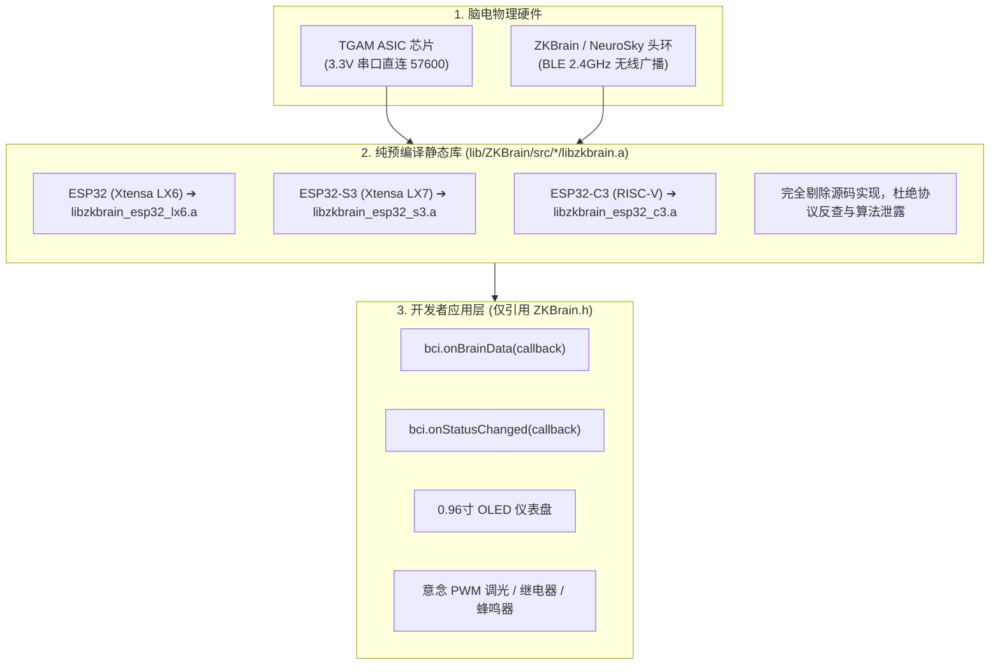

# ZKBrain ESP32 嵌入式脑机接口 SDK 开发套件 (ESP32 MCU BCI SDK)

> **归属组织**：**熵基科技脑机事业部 (ZKTeco Brain-Computer Interface Division)**  
> **核心规范**：**纯预编译二进制静态库交付（Pure Precompiled Static Binary），彻底剔除源码模式，底层协议与硬件点火时序 100% 物理隔离**  
> **支持芯片**：Espressif ESP32 / ESP32-S3 / ESP32-C3  
> **开发框架**：Arduino IDE / PlatformIO (C/C++)  
> **运行日志标准**：**100% 纯英文终端输出**  
> **English Documentation**：[`README_EN.md`](README_EN.md)

---

## 1. 架构简介与纯二进制 SDK 交付

为了彻底保护企业核心脑电协议与算法资产，本工程**完全移除了源码模式**，采用纯预编译二进制静态库架构。开发者仅能接触公开脱敏头文件 [`ZKBrain.h`](lib/ZKBrain/src/ZKBrain.h)，底层帧同步（`0xAA 0xAA`）、双模点火时序（`0x15`/`0x17`）、校验和算法与 BLE 特征值全盘固化在目标芯片机器码中：



---

## 2. 内置预编译静态库归档表

工程在 [`precompiled/`](precompiled/) 与 [`lib/ZKBrain/src/`](lib/ZKBrain/src/) 目录中已全量内置官方编译并通过硬件验证的 3 大芯片架构静态库：

| 芯片架构 | 适用硬件型号 | 静态库文件路径 | 大小 | 工具链与 ABI |
| :--- | :--- | :--- | :--- | :--- |
| **Xtensa LX6 (双核)** | 经典 ESP32 (WROOM-32, NodeMCU-32S) | [`precompiled/esp32/libzkbrain_esp32_lx6.a`](precompiled/esp32/libzkbrain_esp32_lx6.a) | **780 KB** | `xtensa-esp32-elf-g++` (ESP-IDF v5) |
| **Xtensa LX7 (双核)** | ESP32-S3 (DevKitC-1, 矢量指令集款) | [`precompiled/esp32s3/libzkbrain_esp32_s3.a`](precompiled/esp32s3/libzkbrain_esp32_s3.a) | **756 KB** | `xtensa-esp32s3-elf-g++` (ESP-IDF v5) |
| **RISC-V (32位单核)** | ESP32-C3 (DevKitM-1, 物联网精简款) | [`precompiled/esp32c3/libzkbrain_esp32_c3.a`](precompiled/esp32c3/libzkbrain_esp32_c3.a) | **950 KB** | `riscv32-esp-elf-g++` (ESP-IDF v5) |

---

## 3. 极简 10 行 SDK 调用范式

在下游应用中，仅需包含公开头文件 `<ZKBrain.h>`，链接预编译静态库即可运行：

```cpp
#include <Arduino.h>
#include <ZKBrain.h>

ZKBrain bci;

void setup() {
    Serial.begin(115200);

    // 1. 响应式监听脑电综合指标 (1Hz)
    bci.onBrainData([](const ZKBrainData& data) {
        Serial.printf("[BCI] Signal: %d | Attn: %d | Medi: %d\n",
                      data.signal, data.attention, data.meditation);
    });

    // 2. 启动蓝牙无线主机扫描与自动建连 (或使用 bci.beginUart 串口直连)
    bci.beginBle();
}

void loop() {
    // 3. 驱动 SDK 内部状态机与看门狗
    bci.update();
}
```

---

## 4. 硬件引脚定义与接线图

### 4.1 主流 ESP32 芯片引脚映射表

| 功能模块 | 信号引脚 | 经典 ESP32 (WROOM-32) | ESP32-S3 | ESP32-C3 | 说明 |
| :--- | :--- | :--- | :--- | :--- | :--- |
| **TGAM 串口直连** | TGAM TX $\to$ ESP32 RX | **GPIO 16 (RX2)** | GPIO 16 | GPIO 4 | 57600 波特率，3.3V 电平 |
| **TGAM 串口直连** | TGAM RX $\to$ ESP32 TX | **GPIO 17 (TX2)** | GPIO 17 | GPIO 5 | 内部指令透传 |
| **I2C OLED 显示屏** | OLED SDA | **GPIO 21** | GPIO 21 | GPIO 8 | 0.96" SSD1306 128x64 |
| **I2C OLED 显示屏** | OLED SCL | **GPIO 22** | GPIO 22 | GPIO 9 | I2C 地址默认为 `0x3C` |
| **意念 PWM 调光灯** | LED 阳极 (通过限流电阻) | **GPIO 2** | GPIO 2 | GPIO 2 | 专注度 0~100 映射为 PWM |
| **疲劳走神报警蜂鸣器** | 有源蜂鸣器信号脚 | **GPIO 18** | GPIO 18 | GPIO 6 | 低专注或走神触发警报 |
| **高专注意念继电器** | 继电器输入控制脚 IN | **GPIO 19** | GPIO 19 | GPIO 7 | 专注度 $\ge 75$ 吸合，控制电机/门禁 |

### 4.2 TGAM 硬件模块接线示意

```
  TGAM ASIC 模块              ESP32 开发板
┌──────────────────┐        ┌──────────────────┐
│  VCC (3.3V)      │───────>│  3V3             │
│  GND             │───────>│  GND             │
│  TX (57600 baud) │───────>│  GPIO 16 (RX2)   │
│  RX              │<───────│  GPIO 17 (TX2)   │
└──────────────────┘        └──────────────────┘
```

> [!CAUTION]
> TGAM 工作电压必须为 **3.3V**。严禁接入 5V 电源，否则将永久损坏 TGAM 核心芯片！

---

## 5. 快速开始与烧录指南

### 方法 A：使用 PlatformIO (推荐)

PlatformIO 预置了开箱即用的静态库自动链接配置：
1. 在 VS Code 中打开 `templates/mcu-esp32`；
2. 直接执行编译与烧录：
   ```bash
   # 经典 ESP32 (自动链接 precompiled/esp32/libzkbrain_esp32_lx6.a)
   pio run -e esp32dev -t upload

   # ESP32-S3 (自动链接 precompiled/esp32s3/libzkbrain_esp32_s3.a)
   pio run -e esp32-s3-devkitc-1 -t upload

   # ESP32-C3 (自动链接 precompiled/esp32c3/libzkbrain_esp32_c3.a)
   pio run -e esp32-c3-devkitm-1 -t upload

   # 打开串口监视器
   pio device monitor
   ```

### 方法 B：使用 Arduino IDE

1. 将 `templates/mcu-esp32/lib/ZKBrain` 文件夹复制至个人电脑的 Arduino 库目录（`我的文档/Arduino/libraries/`）；
2. 库内遵循 Arduino 1.5 官方预编译标准（包含 `library.properties` 与架构子目录下的 `.a` 文件），Arduino IDE 会自动匹配目标开发板的架构并完成静态库链接；
3. 打开示例工程：
   - [`examples/01_uart_direct_tgam/01_uart_direct_tgam.ino`](examples/01_uart_direct_tgam/01_uart_direct_tgam.ino)：基于 SDK 的 TGAM 极简串口读取
   - [`examples/02_ble_central_headband/02_ble_central_headband.ino`](examples/02_ble_central_headband/02_ble_central_headband.ino)：基于 SDK 的蓝牙主机自连
   - [`examples/03_mind_controlled_actuator/03_mind_controlled_actuator.ino`](examples/03_mind_controlled_actuator/03_mind_controlled_actuator.ino)：意念控制继电器与防走神报警
4. 选择对应的端口与波特率（`115200`），点击上传。

---

## 6. 串口纯英文输出标准 (100% Pure English Telemetry)

```text
========================================================
  ZKBrain Embedded BCI Controller (SDK Powered)
  Platform: Espressif ESP32 / ESP32-S3 / ESP32-C3
  ZKTeco Brain-Computer Interface Division
========================================================

[ESP32] [HARDWARE] SSD1306 OLED initialized at 0x3C.
[ZKBrain] [BLE] Initializing Central BLE subsystem...
[ZKBrain] [BLE] Scanner started. Searching for BCI peripherals...
[ZKBrain] [BLE] Compatible peripheral found: MindWave Mobile [AA:BB:CC:DD:EE:FF]
[ESP32] [SDK] Status -> CONNECTING to BCI device...
[ZKBrain] [BLE] Physical GATT connection established.
[ZKBrain] [BLE] Hardware ignition sequence verified.
[ESP32] [SDK] Status -> CONNECTED. EEG data streaming.
[ESP32] [BCI] Signal:   0 (GOOD) | Attn:  82 | Medi:  64 | Bat: 90% | Actuator: ACTIVE
[ESP32] [ACTUATOR] Mind trigger ACTIVATED! Attention: 82 >= 75
[ESP32] [BCI] Signal:   0 (GOOD) | Attn:  45 | Medi:  58 | Bat: 90% | Actuator: STANDBY
```
