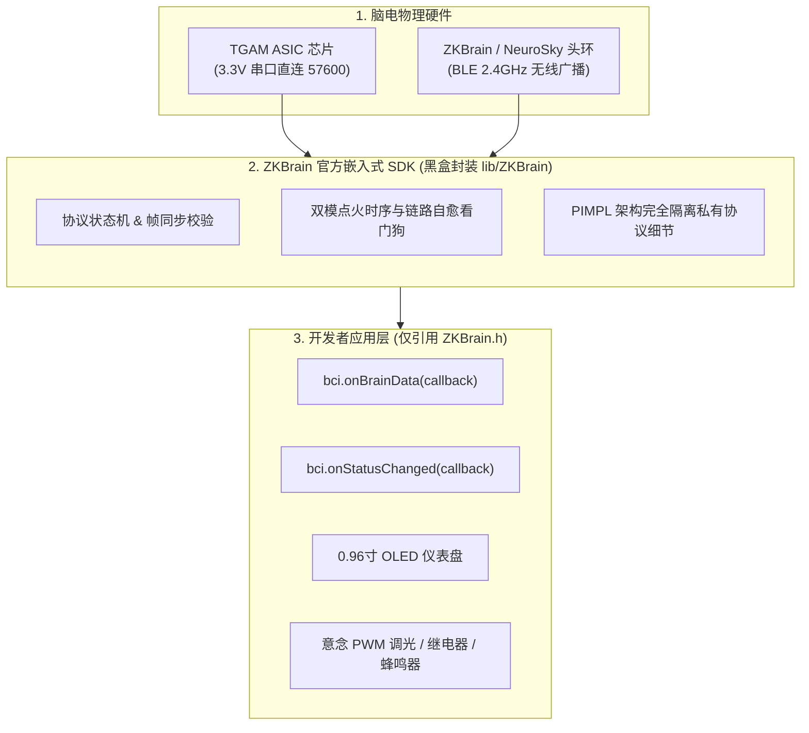

# ZKBrain ESP32 嵌入式脑机接口 SDK 开发套件 (ESP32 MCU BCI SDK)

> **归属组织**：**熵基科技脑机事业部 (ZKTeco Brain-Computer Interface Division)**  
> **核心原则**：**官方黑盒 SDK 抽象，底层二进制协议与硬件点火算法 100% 内部隔离与脱敏**  
> **支持芯片**：Espressif ESP32 / ESP32-S3 / ESP32-C3  
> **开发框架**：Arduino IDE / PlatformIO (C/C++)  
> **运行日志标准**：**100% 纯英文终端输出**  
> **English Documentation**：[`README_EN.md`](README_EN.md)

---

## 1. 架构简介与黑盒 SDK 设计

为了保护核心协议资产与降低下游应用开发门槛，本套件采用**高内聚黑盒 SDK 架构**（`lib/ZKBrain/`）。应用层与创客开发者只需关注高阶脑波事件，无需处理底层的帧同步（`0xAA 0xAA`）、硬件点火指令（`0x15`/`0x17`）、校验和计算或 BLE 特征值排布：



---

## 2. 商业交付与知识产权保护（静态库模式）

在面向商业客户、第三方外协团队或开源交付时，可采用两种分发模式：

### 模式 A：源码库引入（适用于团队内部敏捷开发）
- 将 `lib/ZKBrain` 直接保留在工程中，PlatformIO 会自动扫描并编译；
- Arduino IDE 用户只需将 `lib/ZKBrain` 目录复制至个人电脑的 `Arduino/libraries/` 目录中即可直接 `#include <ZKBrain.h>`。

### 模式 B：二进制静态库交付（已内置在工程 precompiled/ 目录中）
- 工程内置官方交叉编译生成的 3 大主流芯片架构 `.a` 二进制静态归档库（存放于 [`precompiled/`](precompiled/)）：
  - 经典 ESP32 双核 Xtensa LX6：[`precompiled/esp32/libzkbrain_esp32_lx6.a`](precompiled/esp32/libzkbrain_esp32_lx6.a) (780KB)
  - ESP32-S3 双核 Xtensa LX7：[`precompiled/esp32s3/libzkbrain_esp32_s3.a`](precompiled/esp32s3/libzkbrain_esp32_s3.a) (756KB)
  - ESP32-C3 单核 RISC-V 32位：[`precompiled/esp32c3/libzkbrain_esp32_c3.a`](precompiled/esp32c3/libzkbrain_esp32_c3.a) (950KB)
- **交付物规范（完全杜绝源码逆向）**：
  1. 公开纯头文件：[`ZKBrain.h`](lib/ZKBrain/src/ZKBrain.h)（仅含高阶事件接口与数据结构体，不含任何协议常量或宏定义）
  2. 预编译静态库：对应芯片架构的 `.a` 二进制文件
- **成效**：商业客户与外部人员无法通过反查源码获取任何底层通信协议、点火算法或特定厂商硬件逻辑，彻底保护核心技术资产。详细链接指南参见 [`precompiled/README.md`](precompiled/README.md)。

---

## 3. 极简 10 行 SDK 调用范式

在下游应用中，仅需包含 `<ZKBrain.h>`：

```cpp
#include <Arduino.h>
#include <ZKBrain.h>

ZKBrain bci;

void setup() {
    Serial.begin(115200);

    // 1. 响应式监听脑电综合指标 (1Hz)
    bci.onBrainData([](const ZKBrainData& data) {
        Serial.printf("[BCI] Signal: %d | Attn: %d | Medi: %d\n",
                      data.signal, data.attention, data.meditation);
    });

    // 2. 启动蓝牙无线主机扫描与自动建连 (或使用 bci.beginUart 串口直连)
    bci.beginBle();
}

void loop() {
    // 3. 驱动 SDK 内部状态机与看门狗
    bci.update();
}
```

---

## 4. 硬件引脚定义与接线图

### 4.1 主流 ESP32 芯片引脚映射表

| 功能模块 | 信号引脚 | 经典 ESP32 (WROOM-32) | ESP32-S3 | ESP32-C3 | 说明 |
| :--- | :--- | :--- | :--- | :--- | :--- |
| **TGAM 串口直连** | TGAM TX $\to$ ESP32 RX | **GPIO 16 (RX2)** | GPIO 16 | GPIO 4 | 57600 波特率，3.3V 电平 |
| **TGAM 串口直连** | TGAM RX $\to$ ESP32 TX | **GPIO 17 (TX2)** | GPIO 17 | GPIO 5 | 内部指令透传 |
| **I2C OLED 显示屏** | OLED SDA | **GPIO 21** | GPIO 21 | GPIO 8 | 0.96" SSD1306 128x64 |
| **I2C OLED 显示屏** | OLED SCL | **GPIO 22** | GPIO 22 | GPIO 9 | I2C 地址默认为 `0x3C` |
| **意念 PWM 调光灯** | LED 阳极 (通过限流电阻) | **GPIO 2** | GPIO 2 | GPIO 2 | 专注度 0~100 映射为 PWM |
| **疲劳走神报警蜂鸣器** | 有源蜂鸣器信号脚 | **GPIO 18** | GPIO 18 | GPIO 6 | 低专注或走神触发警报 |
| **高专注意念继电器** | 继电器输入控制脚 IN | **GPIO 19** | GPIO 19 | GPIO 7 | 专注度 $\ge 75$ 吸合，控制电机/门禁 |

### 4.2 TGAM 硬件模块接线示意

```
  TGAM ASIC 模块              ESP32 开发板
┌──────────────────┐        ┌──────────────────┐
│  VCC (3.3V)      │───────>│  3V3             │
│  GND             │───────>│  GND             │
│  TX (57600 baud) │───────>│  GPIO 16 (RX2)   │
│  RX              │<───────│  GPIO 17 (TX2)   │
└──────────────────┘        └──────────────────┘
```

> [!CAUTION]
> TGAM 工作电压必须为 **3.3V**。严禁接入 5V 电源，否则将永久损坏 TGAM 核心芯片！

---

## 5. 运行模式配置 (`include/Config.h`)

在 [`include/Config.h`](include/Config.h) 中可自由切换双模运行方式：

```c
// 1. 无线蓝牙主机模式 (默认)：自动扫描连接周边的 MindWave / ZKBrain 头环
#define MODE_BLE_CENTRAL    1
#define MODE_UART_DIRECT    0

// 2. 硬件串口直连模式：直接读取头盔/智能眼罩内部 TGAM 芯片引脚
#define MODE_BLE_CENTRAL    0
#define MODE_UART_DIRECT    1
```

---

## 6. 快速开始与烧录指南

### 方法 A：使用 PlatformIO (推荐)

1. 在 VS Code 中安装 **PlatformIO IDE** 插件；
2. 打开 `templates/mcu-esp32` 目录；
3. 选择开发板构建环境并烧录：
   ```bash
   # 编译并烧录到经典 ESP32
   pio run -e esp32dev -t upload

   # 编译并烧录到 ESP32-S3
   pio run -e esp32-s3-devkitc-1 -t upload

   # 编译并烧录到 ESP32-C3
   pio run -e esp32-c3-devkitm-1 -t upload

   # 打开 115200 波特率串口监视器
   pio device monitor
   ```

### 方法 B：使用 Arduino IDE

1. 打开 Arduino IDE（建议 2.0+ 版本）；
2. 将 `templates/mcu-esp32/lib/ZKBrain` 文件夹复制至 Arduino 库目录（通常位于 `我的文档/Arduino/libraries/`）；
3. 打开示例工程：
   - [`examples/01_uart_direct_tgam/01_uart_direct_tgam.ino`](examples/01_uart_direct_tgam/01_uart_direct_tgam.ino)：基于 SDK 的 TGAM 极简串口读取
   - [`examples/02_ble_central_headband/02_ble_central_headband.ino`](examples/02_ble_central_headband/02_ble_central_headband.ino)：基于 SDK 的蓝牙主机自连
   - [`examples/03_mind_controlled_actuator/03_mind_controlled_actuator.ino`](examples/03_mind_controlled_actuator/03_mind_controlled_actuator.ino)：意念控制继电器与防走神报警
4. 选择对应的端口与波特率（`115200`），点击上传。

---

## 7. 串口纯英文输出标准 (100% Pure English Telemetry)

系统启动及运行时，串口以标准 115200 波特率输出全英文格式化日志：

```text
========================================================
  ZKBrain Embedded BCI Controller (SDK Powered)
  Platform: Espressif ESP32 / ESP32-S3 / ESP32-C3
  ZKTeco Brain-Computer Interface Division
========================================================

[ESP32] [HARDWARE] SSD1306 OLED initialized at 0x3C.
[ZKBrain] [BLE] Initializing Central BLE subsystem...
[ZKBrain] [BLE] Scanner started. Searching for BCI peripherals...
[ZKBrain] [BLE] Compatible peripheral found: MindWave Mobile [AA:BB:CC:DD:EE:FF]
[ESP32] [SDK] Status -> CONNECTING to BCI device...
[ZKBrain] [BLE] Physical GATT connection established.
[ZKBrain] [BLE] Hardware ignition sequence verified.
[ESP32] [SDK] Status -> CONNECTED. EEG data streaming.
[ESP32] [BCI] Signal:   0 (GOOD) | Attn:  82 | Medi:  64 | Bat: 90% | Actuator: ACTIVE
[ESP32] [ACTUATOR] Mind trigger ACTIVATED! Attention: 82 >= 75
[ESP32] [BCI] Signal:   0 (GOOD) | Attn:  45 | Medi:  58 | Bat: 90% | Actuator: STANDBY
```
