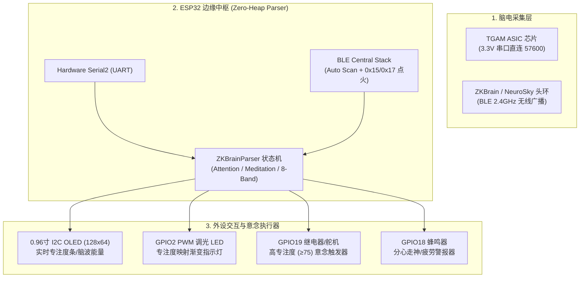

# ZKBrain ESP32 嵌入式脑机接口开发套件 (ESP32 MCU BCI Starter)

> **归属组织**：**熵基科技脑机事业部 (ZKTeco Brain-Computer Interface Division)**  
> **支持芯片**：Espressif ESP32 / ESP32-S3 / ESP32-C3  
> **开发框架**：Arduino IDE / PlatformIO (C/C++)  
> **运行日志标准**：**100% 纯英文终端输出**  
> **English Documentation**：[`README_EN.md`](README_EN.md)

---

## 1. 架构简介与核心能力

本工程是专为微控制器与物联网边缘端打造的工业级嵌入式脑机接口开发脚手架。通过极低内存开销（零动态内存分配，防止堆碎片化）实现 TGAM ASIC 与 ZKBrain 脑机外设的硬核实时解析，支持双模连接与意念物理执行器联动：



---

## 2. 硬件引脚定义与接线图

### 2.1 主流 ESP32 芯片引脚映射表

| 功能模块 | 信号引脚 | 经典 ESP32 (WROOM-32) | ESP32-S3 | ESP32-C3 | 说明 |
| :--- | :--- | :--- | :--- | :--- | :--- |
| **TGAM 串口直连** | TGAM TX $\to$ ESP32 RX | **GPIO 16 (RX2)** | GPIO 16 | GPIO 4 | 57600 波特率，3.3V 电平 |
| **TGAM 串口直连** | TGAM RX $\to$ ESP32 TX | **GPIO 17 (TX2)** | GPIO 17 | GPIO 5 | 可选，下发控制指令 |
| **I2C OLED 显示屏** | OLED SDA | **GPIO 21** | GPIO 21 | GPIO 8 | 0.96" SSD1306 128x64 |
| **I2C OLED 显示屏** | OLED SCL | **GPIO 22** | GPIO 22 | GPIO 9 | I2C 地址默认为 `0x3C` |
| **意念 PWM 调光灯** | LED 阳极 (通过限流电阻) | **GPIO 2** | GPIO 2 | GPIO 2 | 专注度 0~100 映射为 PWM |
| **疲劳走神报警蜂鸣器** | 有源蜂鸣器信号脚 | **GPIO 18** | GPIO 18 | GPIO 6 | 低专注或走神触发警报 |
| **高专注意念继电器** | 继电器输入控制脚 IN | **GPIO 19** | GPIO 19 | GPIO 7 | 专注度 $\ge 75$ 吸合，控制电机/门禁 |

### 2.2 TGAM 硬件模块接线示意

```
  TGAM ASIC 模块              ESP32 开发板
┌──────────────────┐        ┌──────────────────┐
│  VCC (3.3V)      │───────>│  3V3             │
│  GND             │───────>│  GND             │
│  TX (57600 baud) │───────>│  GPIO 16 (RX2)   │
│  RX              │<───────│  GPIO 17 (TX2)   │
└──────────────────┘        └──────────────────┘
```

> [!CAUTION]
> TGAM 工作电压必须为 **3.3V**。严禁接入 5V 电源，否则将永久损坏 TGAM 核心芯片！

---

## 3. 运行模式配置 (`include/Config.h`)

在 [`include/Config.h`](include/Config.h) 中可自由切换双模运行方式：

```c
// 1. 无线蓝牙主机模式 (默认)：自动扫描连接周边的 MindWave / ZKBrain 头环
#define MODE_BLE_CENTRAL    1
#define MODE_UART_DIRECT    0

// 2. 硬件串口直连模式：直接读取头盔/智能眼罩内部 TGAM 芯片引脚
#define MODE_BLE_CENTRAL    0
#define MODE_UART_DIRECT    1
```

---

## 4. 快速开始与烧录指南

### 方法 A：使用 PlatformIO (推荐)

1. 在 VS Code 中安装 **PlatformIO IDE** 插件；
2. 打开 `templates/mcu-esp32` 目录；
3. 选择对应的开发板环境（默认为 `esp32dev`）：
   ```bash
   # 编译并烧录到经典 ESP32
   pio run -e esp32dev -t upload

   # 编译并烧录到 ESP32-S3
   pio run -e esp32-s3-devkitc-1 -t upload

   # 编译并烧录到 ESP32-C3
   pio run -e esp32-c3-devkitm-1 -t upload

   # 打开 115200 波特率串口监视器
   pio device monitor
   ```

### 方法 B：使用 Arduino IDE

1. 打开 Arduino IDE（建议 2.0+ 版本）；
2. 进入 `File -> Preferences`，在附加板管理器网址中填入：
   `https://raw.githubusercontent.com/espressif/arduino-esp32/gh-pages/package_esp32_index.json`
3. 在 `Tools -> Board Manager` 中搜索并安装 **esp32** 支持包；
4. 在 `Sketch -> Include Library -> Manage Libraries` 中安装：
   - **Adafruit SSD1306**
   - **Adafruit GFX Library**
5. 打开示例工程：
   - [`examples/01_uart_direct_tgam/01_uart_direct_tgam.ino`](examples/01_uart_direct_tgam/01_uart_direct_tgam.ino)：单芯片 TGAM 极简串口读取
   - [`examples/02_ble_central_headband/02_ble_central_headband.ino`](examples/02_ble_central_headband/02_ble_central_headband.ino)：无线蓝牙主机搜索直连
   - [`examples/03_mind_controlled_actuator/03_mind_controlled_actuator.ino`](examples/03_mind_controlled_actuator/03_mind_controlled_actuator.ino)：意念控制继电器与防走神报警
6. 选择对应的端口与波特率（`115200`），点击上传。

---

## 5. 串口纯英文输出标准 (100% Pure English Telemetry)

系统启动及运行时，串口以标准 115200 波特率输出全英文格式化日志，无任何乱码：

```text
========================================================
  ZKBrain Embedded BCI Controller Firmware
  Platform: Espressif ESP32 / ESP32-S3 / ESP32-C3
  ZKTeco Brain-Computer Interface Division
========================================================

[ESP32] [HARDWARE] SSD1306 OLED initialized at 0x3C.
[ESP32] [BLE] Initializing BLE Central stack...
[ESP32] [BLE] Scanner active, listening for BCI headbands...
[ESP32] [BLE] Discovered device: MindWave Mobile [AA:BB:CC:DD:EE:FF] RSSI: -58 dBm
[ESP32] [BLE] Target BCI peripheral found: MindWave Mobile. Initiating link...
[ESP32] [BLE] Connecting to BCI server at aa:bb:cc:dd:ee:ff...
[ESP32] [BLE] GATT connection established successfully.
[ESP32] [BLE] Registered notification callback.
[ESP32] [BLE] Dispatched NeuroSky ignition packet (0x15 Raw + 0x17 Band).
[ESP32] [BLE] Connected and synchronized with BCI peripheral.
[ESP32] [BCI] Signal:   0 (GOOD) | Attn:  82 | Medi:  64 | Bat: 90% | Actuator: ACTIVE
[ESP32] [ACTUATOR] Mind trigger ACTIVATED! Attention: 82 >= 75
[ESP32] [BCI] Signal:   0 (GOOD) | Attn:  45 | Medi:  58 | Bat: 90% | Actuator: STANDBY
```

---

## 6. 避坑与硬件须知

1. **NeuroSky 点火包机制**：
   - MindWave 物理建连后**不会主动上报数据**。本固件在建连后已自动向特征值写入 `0x15` (Raw 512Hz) 与 `0x17` (ASIC 8-Band) 点火指令；
2. **电容放电死锁防护**：
   - 若手动关闭头环电源开关，头环内部滤波电容需 **2~3 秒完全放电**。若秒关秒开会导致蓝牙芯片挂起，请提示等待 3 秒再开机；
3. **电极脱落安全互锁**：
   - 当检测到接触不良或脱落 (`Signal == 200`) 时，固件自动将所有物理执行器与继电器强制断开，防止误动作。
