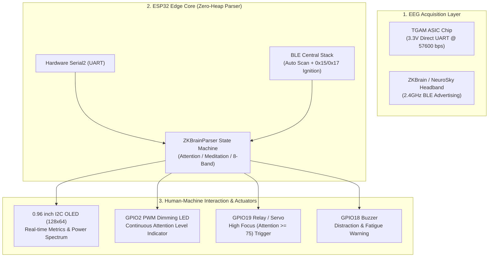

# ZKBrain ESP32 Embedded BCI Starter Kit

> **Organization**: **ZKTeco Brain-Computer Interface Division**  
> **Supported Microcontrollers**: Espressif ESP32 / ESP32-S3 / ESP32-C3  
> **Framework**: Arduino IDE / PlatformIO (C/C++)  
> **Serial Output Standard**: **100% Pure English Telemetry**  
> **Chinese Documentation**: [`README.md`](README.md)

---

## 1. Overview & Key Capabilities

This project is an industrial-grade embedded Brain-Computer Interface (BCI) developer kit designed specifically for microcontrollers and edge IoT devices. Engineered with zero dynamic heap allocation to eliminate memory fragmentation, it delivers real-time parsing of TGAM ASIC and ZKBrain peripheral data with dual-mode connectivity and mind-controlled physical actuators:



---

## 2. Hardware Pinouts & Wiring Diagrams

### 2.1 MCU Pin Mapping Table

| Function | Signal | Classic ESP32 (WROOM-32) | ESP32-S3 | ESP32-C3 | Description |
| :--- | :--- | :--- | :--- | :--- | :--- |
| **TGAM Direct UART** | TGAM TX $\to$ ESP32 RX | **GPIO 16 (RX2)** | GPIO 16 | GPIO 4 | 57600 baud rate, 3.3V TTL |
| **TGAM Direct UART** | TGAM RX $\to$ ESP32 TX | **GPIO 17 (TX2)** | GPIO 17 | GPIO 5 | Optional control commands |
| **I2C OLED Display** | OLED SDA | **GPIO 21** | GPIO 21 | GPIO 8 | 0.96" SSD1306 128x64 |
| **I2C OLED Display** | OLED SCL | **GPIO 22** | GPIO 22 | GPIO 9 | Default I2C address: `0x3C` |
| **Attention PWM LED** | LED Anode (via resistor) | **GPIO 2** | GPIO 2 | GPIO 2 | Mapped from Attention (0~100) |
| **Fatigue / Alarm Buzzer**| Active Buzzer Signal | **GPIO 18** | GPIO 18 | GPIO 6 | Triggered on distraction / low focus |
| **Mind-Triggered Relay** | Relay Input IN | **GPIO 19** | GPIO 19 | GPIO 7 | Closes when Attention $\ge 75$ |

### 2.2 TGAM Hardware Module Direct Wiring

```
  TGAM ASIC Module            ESP32 Development Board
┌──────────────────┐        ┌──────────────────┐
│  VCC (3.3V)      │───────>│  3V3             │
│  GND             │───────>│  GND             │
│  TX (57600 baud) │───────>│  GPIO 16 (RX2)   │
│  RX              │<───────│  GPIO 17 (TX2)   │
└──────────────────┘        └──────────────────┘
```

> [!CAUTION]
> The operating voltage of TGAM must strictly be **3.3V**. Connecting to a 5V rail will permanently destroy the ASIC!

---

## 3. Operating Mode Switch (`include/Config.h`)

You can switch between wireless BLE Central and direct hardware UART in [`include/Config.h`](include/Config.h):

```c
// Mode 1: Wireless BLE Central Mode (Default)
// Automatically scans and connects to nearby MindWave / ZKBrain headbands
#define MODE_BLE_CENTRAL    1
#define MODE_UART_DIRECT    0

// Mode 2: Direct Hardware UART Mode
// Direct connection to TGAM ASIC pins inside helmets or smart eye masks
#define MODE_BLE_CENTRAL    0
#define MODE_UART_DIRECT    1
```

---

## 4. Quick Start & Flashing Guide

### Method A: Using PlatformIO (Recommended)

1. Install **PlatformIO IDE** extension in VS Code.
2. Open the `templates/mcu-esp32` directory.
3. Select your target environment (`esp32dev` is default):
   ```bash
   # Build and flash to classic ESP32
   pio run -e esp32dev -t upload

   # Build and flash to ESP32-S3
   pio run -e esp32-s3-devkitc-1 -t upload

   # Build and flash to ESP32-C3
   pio run -e esp32-c3-devkitm-1 -t upload

   # Open 115200 baud serial monitor
   pio device monitor
   ```

### Method B: Using Arduino IDE

1. Open Arduino IDE (version 2.0+ recommended).
2. Go to `File -> Preferences`, add the ESP32 board URL:
   `https://raw.githubusercontent.com/espressif/arduino-esp32/gh-pages/package_esp32_index.json`
3. Go to `Tools -> Board Manager`, search and install **esp32**.
4. Go to `Sketch -> Include Library -> Manage Libraries`, install:
   - **Adafruit SSD1306**
   - **Adafruit GFX Library**
5. Open an example sketch:
   - [`examples/01_uart_direct_tgam/01_uart_direct_tgam.ino`](examples/01_uart_direct_tgam/01_uart_direct_tgam.ino): TGAM ASIC direct serial reader.
   - [`examples/02_ble_central_headband/02_ble_central_headband.ino`](examples/02_ble_central_headband/02_ble_central_headband.ino): BLE Central wireless auto-scanner.
   - [`examples/03_mind_controlled_actuator/03_mind_controlled_actuator.ino`](examples/03_mind_controlled_actuator/03_mind_controlled_actuator.ino): Mind-controlled physical actuation.
6. Select your serial port and board, then click Upload.

---

## 5. Serial Telemetry Standard (100% Pure English)

At boot and during runtime, the serial monitor outputs structured pure English telemetry at 115200 baud:

```text
========================================================
  ZKBrain Embedded BCI Controller Firmware
  Platform: Espressif ESP32 / ESP32-S3 / ESP32-C3
  ZKTeco Brain-Computer Interface Division
========================================================

[ESP32] [HARDWARE] SSD1306 OLED initialized at 0x3C.
[ESP32] [BLE] Initializing BLE Central stack...
[ESP32] [BLE] Scanner active, listening for BCI headbands...
[ESP32] [BLE] Discovered device: MindWave Mobile [AA:BB:CC:DD:EE:FF] RSSI: -58 dBm
[ESP32] [BLE] Target BCI peripheral found: MindWave Mobile. Initiating link...
[ESP32] [BLE] Connecting to BCI server at aa:bb:cc:dd:ee:ff...
[ESP32] [BLE] GATT connection established successfully.
[ESP32] [BLE] Registered notification callback.
[ESP32] [BLE] Dispatched NeuroSky ignition packet (0x15 Raw + 0x17 Band).
[ESP32] [BLE] Connected and synchronized with BCI peripheral.
[ESP32] [BCI] Signal:   0 (GOOD) | Attn:  82 | Medi:  64 | Bat: 90% | Actuator: ACTIVE
[ESP32] [ACTUATOR] Mind trigger ACTIVATED! Attention: 82 >= 75
[ESP32] [BCI] Signal:   0 (GOOD) | Attn:  45 | Medi:  58 | Bat: 90% | Actuator: STANDBY
```

---

## 6. Hardware Troubleshooting & Safeguards

1. **NeuroSky Ignition Requirement**:
   - MindWave devices will **never send EEG data voluntarily** upon BLE connection. This firmware automatically sends `0x15` (512Hz Raw) and `0x17` (ASIC 8-Band) packets immediately after GATT handshake.
2. **Capacitor Discharge Deadlock Prevention**:
   - When power is switched off, internal capacitors take **2~3 seconds to discharge**. Powering back on instantly puts the BLE chip into a half-reset state. Wait at least 3 seconds before turning on.
3. **Off-Head Safety Interlock**:
   - When poor contact or detachment is detected (`Signal == 200`), the firmware immediately disables relays and actuators to prevent unintended triggers.
