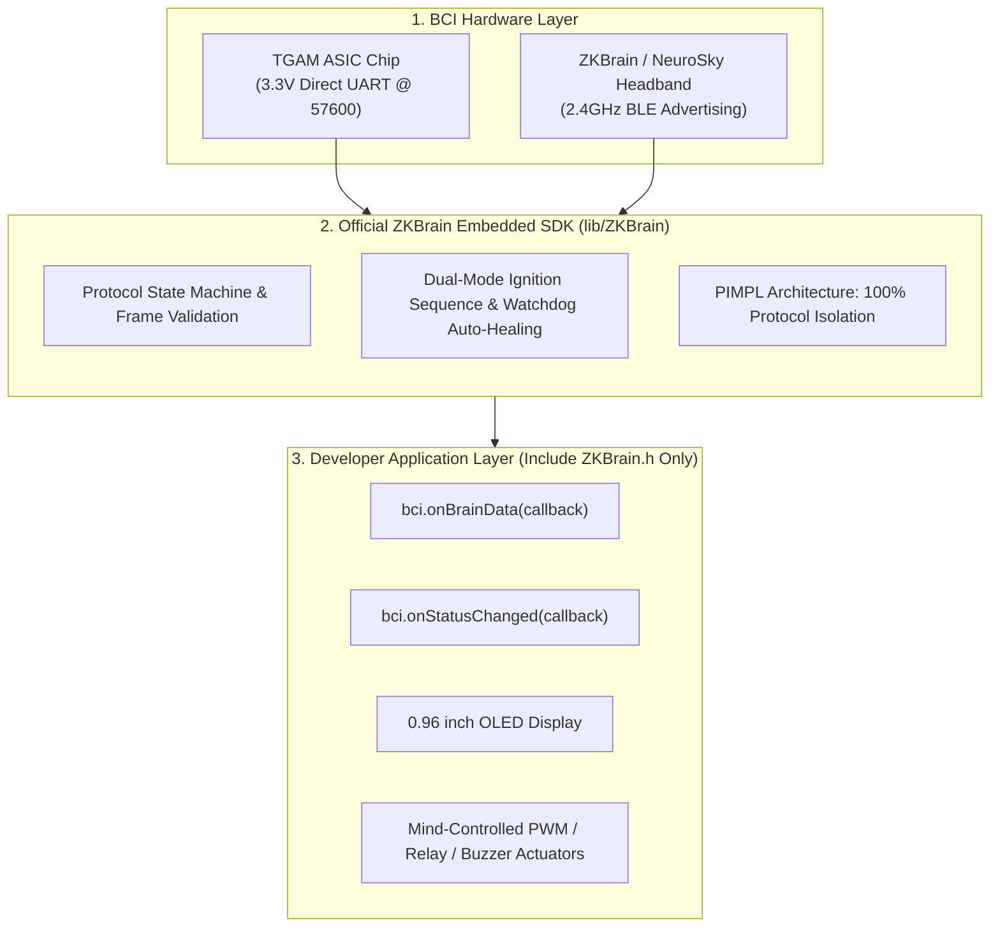

# ZKBrain ESP32 Embedded BCI SDK Starter Kit

> **Organization**: **ZKTeco Brain-Computer Interface Division**  
> **Core Principle**: **Official black-box SDK abstraction; low-level binary protocols and hardware ignition algorithms are 100% encapsulated and shielded.**  
> **Supported Microcontrollers**: Espressif ESP32 / ESP32-S3 / ESP32-C3  
> **Framework**: Arduino IDE / PlatformIO (C/C++)  
> **Serial Output Standard**: **100% Pure English Telemetry**  
> **Chinese Documentation**: [`README.md`](README.md)

---

## 1. Overview & Black-Box SDK Architecture

To safeguard proprietary intellectual property and streamline developer integration, this kit adopts a **highly cohesive black-box SDK architecture** (`lib/ZKBrain/`). Application and maker developers interact solely with high-level cognitive event streams, completely isolated from low-level frame synchronization (`0xAA 0xAA`), hardware ignition packets (`0x15`/`0x17`), checksums, and BLE characteristic mapping:



---

## 2. Commercial Delivery & IP Protection (Static Library Mode)

When distributing to commercial clients, third-party contractors, or open-source environments, two integration patterns are supported:

### Mode A: Source Library Inclusion (Internal Rapid Prototyping)
- Keep `lib/ZKBrain` inside the project. PlatformIO auto-detects and compiles it;
- Arduino IDE developers can copy `lib/ZKBrain` into their `Arduino/libraries/` folder to `#include <ZKBrain.h>` directly.

### Mode B: Precompiled Static Binary Delivery (Commercial IP Protection)
- Compile `lib/ZKBrain/src/ZKBrain.cpp` into precompiled static archives via PlatformIO or ESP-IDF:
  - `libzkbrain_esp32_lx6.a` (Classic ESP32 Dual-Core Xtensa LX6)
  - `libzkbrain_esp32_s3.a` (ESP32-S3 Xtensa LX7)
  - `libzkbrain_esp32_c3.a` (ESP32-C3 RISC-V)
- Deliverables strictly contain:
  1. Clean public header: [`ZKBrain.h`](lib/ZKBrain/src/ZKBrain.h) (Interfaces & structs only; zero protocol hex codes or macros)
  2. Precompiled static binary: `libzkbrain_esp32.a`
- **Result**: Downstream developers and external partners cannot reverse-engineer or inspect raw communication protocols, ignition sequences, or proprietary hardware logic.

---

## 3. Minimal 10-Line SDK Usage

In your application code, simply include `<ZKBrain.h>`:

```cpp
#include <Arduino.h>
#include <ZKBrain.h>

ZKBrain bci;

void setup() {
    Serial.begin(115200);

    // 1. Reactive listener for 1Hz cognitive metrics
    bci.onBrainData([](const ZKBrainData& data) {
        Serial.printf("[BCI] Signal: %d | Attn: %d | Medi: %d\n",
                      data.signal, data.attention, data.meditation);
    });

    // 2. Start wireless BLE Central scanner (or bci.beginUart for direct serial)
    bci.beginBle();
}

void loop() {
    // 3. Drive SDK internal state machine and watchdog
    bci.update();
}
```

---

## 4. Hardware Pinouts & Wiring

### 4.1 Pin Mapping Table

| Function | Signal | Classic ESP32 (WROOM-32) | ESP32-S3 | ESP32-C3 | Description |
| :--- | :--- | :--- | :--- | :--- | :--- |
| **TGAM Direct UART** | TGAM TX $\to$ ESP32 RX | **GPIO 16 (RX2)** | GPIO 16 | GPIO 4 | 57600 baud rate, 3.3V TTL |
| **TGAM Direct UART** | TGAM RX $\to$ ESP32 TX | **GPIO 17 (TX2)** | GPIO 17 | GPIO 5 | Internal command dispatch |
| **I2C OLED Display** | OLED SDA | **GPIO 21** | GPIO 21 | GPIO 8 | 0.96" SSD1306 128x64 |
| **I2C OLED Display** | OLED SCL | **GPIO 22** | GPIO 22 | GPIO 9 | Default I2C address: `0x3C` |
| **Attention PWM LED** | LED Anode (via resistor) | **GPIO 2** | GPIO 2 | GPIO 2 | Mapped from Attention (0~100) |
| **Fatigue / Alarm Buzzer**| Active Buzzer Signal | **GPIO 18** | GPIO 18 | GPIO 6 | Triggered on distraction / low focus |
| **Mind-Triggered Relay** | Relay Input IN | **GPIO 19** | GPIO 19 | GPIO 7 | Closes when Attention $\ge 75$ |

### 4.2 TGAM Direct Wiring Diagram

```
  TGAM ASIC Module            ESP32 Development Board
┌──────────────────┐        ┌──────────────────┐
│  VCC (3.3V)      │───────>│  3V3             │
│  GND             │───────>│  GND             │
│  TX (57600 baud) │───────>│  GPIO 16 (RX2)   │
│  RX              │<───────│  GPIO 17 (TX2)   │
└──────────────────┘        └──────────────────┘
```

> [!CAUTION]
> TGAM operating voltage must strictly be **3.3V**. Connecting to a 5V supply will destroy the ASIC!

---

## 5. Operating Mode Switch (`include/Config.h`)

Select your connection mode in [`include/Config.h`](include/Config.h):

```c
// Mode 1: Wireless BLE Central Mode (Default)
#define MODE_BLE_CENTRAL    1
#define MODE_UART_DIRECT    0

// Mode 2: Direct Hardware UART Mode (Helmets / Wearables)
#define MODE_BLE_CENTRAL    0
#define MODE_UART_DIRECT    1
```

---

## 6. Flashing Guide

### Method A: PlatformIO (Recommended)

1. Open `templates/mcu-esp32` in VS Code with PlatformIO extension;
2. Build and flash for your board:
   ```bash
   pio run -e esp32dev -t upload
   pio device monitor
   ```

### Method B: Arduino IDE

1. Copy `templates/mcu-esp32/lib/ZKBrain` to your Arduino `libraries/` folder;
2. Open any example sketch:
   - [`examples/01_uart_direct_tgam/01_uart_direct_tgam.ino`](examples/01_uart_direct_tgam/01_uart_direct_tgam.ino)
   - [`examples/02_ble_central_headband/02_ble_central_headband.ino`](examples/02_ble_central_headband/02_ble_central_headband.ino)
   - [`examples/03_mind_controlled_actuator/03_mind_controlled_actuator.ino`](examples/03_mind_controlled_actuator/03_mind_controlled_actuator.ino)
3. Select board and port, then click Upload.

---

## 7. Pure English Telemetry Standard

```text
========================================================
  ZKBrain Embedded BCI Controller (SDK Powered)
  Platform: Espressif ESP32 / ESP32-S3 / ESP32-C3
  ZKTeco Brain-Computer Interface Division
========================================================

[ESP32] [HARDWARE] SSD1306 OLED initialized at 0x3C.
[ZKBrain] [BLE] Initializing Central BLE subsystem...
[ZKBrain] [BLE] Scanner started. Searching for BCI peripherals...
[ZKBrain] [BLE] Compatible peripheral found: MindWave Mobile [AA:BB:CC:DD:EE:FF]
[ESP32] [SDK] Status -> CONNECTING to BCI device...
[ZKBrain] [BLE] Physical GATT connection established.
[ZKBrain] [BLE] Hardware ignition sequence verified.
[ESP32] [SDK] Status -> CONNECTED. EEG data streaming.
[ESP32] [BCI] Signal:   0 (GOOD) | Attn:  82 | Medi:  64 | Bat: 90% | Actuator: ACTIVE
[ESP32] [ACTUATOR] Mind trigger ACTIVATED! Attention: 82 >= 75
[ESP32] [BCI] Signal:   0 (GOOD) | Attn:  45 | Medi:  58 | Bat: 90% | Actuator: STANDBY
```
