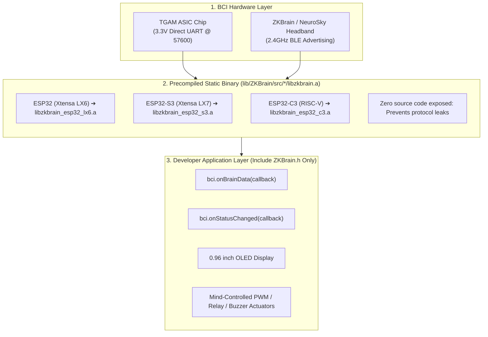

# ZKBrain ESP32 Embedded BCI SDK Starter Kit

> **Organization**: **ZKTeco Brain-Computer Interface Division**  
> **Core Specification**: **100% Precompiled Static Binary Delivery (Source mode completely removed). Proprietary protocol and ignition sequences are entirely encapsulated in compiled machine code.**  
> **Supported Microcontrollers**: Espressif ESP32 / ESP32-S3 / ESP32-C3  
> **Framework**: Arduino IDE / PlatformIO (C/C++)  
> **Serial Output Standard**: **100% Pure English Telemetry**  
> **Chinese Documentation**: [`README.md`](README.md)

---

## 1. Overview & Pure Binary SDK Distribution

To provide absolute protection for enterprise intellectual property and eliminate protocol reverse-engineering, this project **completely removes source code mode**. The SDK is delivered exclusively as precompiled static libraries. Application developers interact with the public header [`ZKBrain.h`](lib/ZKBrain/src/ZKBrain.h) only:



---

## 2. Bundled Precompiled Static Archives

Precompiled and hardware-validated static libraries are bundled in [`precompiled/`](precompiled/) and [`lib/ZKBrain/src/`](lib/ZKBrain/src/):

| Target Architecture | Chip Model | Precompiled Archive | Size | Toolchain / ABI |
| :--- | :--- | :--- | :--- | :--- |
| **Xtensa LX6 (Dual Core)** | Classic ESP32 (WROOM-32, NodeMCU-32S) | [`precompiled/esp32/libzkbrain_esp32_lx6.a`](precompiled/esp32/libzkbrain_esp32_lx6.a) | **780 KB** | `xtensa-esp32-elf-g++` (ESP-IDF v5) |
| **Xtensa LX7 (Dual Core)** | ESP32-S3 (DevKitC-1, Vector instruction model) | [`precompiled/esp32s3/libzkbrain_esp32_s3.a`](precompiled/esp32s3/libzkbrain_esp32_s3.a) | **756 KB** | `xtensa-esp32s3-elf-g++` (ESP-IDF v5) |
| **RISC-V 32-bit (Single Core)** | ESP32-C3 (DevKitM-1, Compact IoT model) | [`precompiled/esp32c3/libzkbrain_esp32_c3.a`](precompiled/esp32c3/libzkbrain_esp32_c3.a) | **950 KB** | `riscv32-esp-elf-g++` (ESP-IDF v5) |

---

## 3. Minimal 10-Line SDK Usage

Simply include `<ZKBrain.h>` and link the static library:

```cpp
#include <Arduino.h>
#include <ZKBrain.h>

ZKBrain bci;

void setup() {
    Serial.begin(115200);

    // 1. Reactive listener for 1Hz cognitive metrics
    bci.onBrainData([](const ZKBrainData& data) {
        Serial.printf("[BCI] Signal: %d | Attn: %d | Medi: %d\n",
                      data.signal, data.attention, data.meditation);
    });

    // 2. Start wireless BLE Central scanner (or bci.beginUart for direct serial)
    bci.beginBle();
}

void loop() {
    // 3. Drive SDK internal state machine and watchdog
    bci.update();
}
```

---

## 4. Hardware Pinouts & Wiring

### 4.1 Pin Mapping Table

| Function | Signal | Classic ESP32 (WROOM-32) | ESP32-S3 | ESP32-C3 | Description |
| :--- | :--- | :--- | :--- | :--- | :--- |
| **TGAM Direct UART** | TGAM TX $\to$ ESP32 RX | **GPIO 16 (RX2)** | GPIO 16 | GPIO 4 | 57600 baud rate, 3.3V TTL |
| **TGAM Direct UART** | TGAM RX $\to$ ESP32 TX | **GPIO 17 (TX2)** | GPIO 17 | GPIO 5 | Internal command dispatch |
| **I2C OLED Display** | OLED SDA | **GPIO 21** | GPIO 21 | GPIO 8 | 0.96" SSD1306 128x64 |
| **I2C OLED Display** | OLED SCL | **GPIO 22** | GPIO 22 | GPIO 9 | Default I2C address: `0x3C` |
| **Attention PWM LED** | LED Anode (via resistor) | **GPIO 2** | GPIO 2 | GPIO 2 | Mapped from Attention (0~100) |
| **Fatigue / Alarm Buzzer**| Active Buzzer Signal | **GPIO 18** | GPIO 18 | GPIO 6 | Triggered on distraction / low focus |
| **Mind-Triggered Relay** | Relay Input IN | **GPIO 19** | GPIO 19 | GPIO 7 | Closes when Attention $\ge 75$ |

### 4.2 TGAM Direct Wiring Diagram

```
  TGAM ASIC Module            ESP32 Development Board
┌──────────────────┐        ┌──────────────────┐
│  VCC (3.3V)      │───────>│  3V3             │
│  GND             │───────>│  GND             │
│  TX (57600 baud) │───────>│  GPIO 16 (RX2)   │
│  RX              │<───────│  GPIO 17 (TX2)   │
└──────────────────┘        └──────────────────┘
```

> [!CAUTION]
> TGAM operating voltage must strictly be **3.3V**. Connecting to a 5V supply will destroy the ASIC!

---

## 5. Flashing Guide

### Method A: PlatformIO (Recommended)

PlatformIO is pre-configured to link the static library automatically:
```bash
# Classic ESP32
pio run -e esp32dev -t upload

# ESP32-S3
pio run -e esp32-s3-devkitc-1 -t upload

# ESP32-C3
pio run -e esp32-c3-devkitm-1 -t upload

# Serial Monitor
pio device monitor
```

### Method B: Arduino IDE

1. Copy `templates/mcu-esp32/lib/ZKBrain` to your Arduino `libraries/` folder;
2. Conforms to the official Arduino 1.5 precompiled library specification (`library.properties` + precompiled `.a` per architecture);
3. Open any example sketch:
   - [`examples/01_uart_direct_tgam/01_uart_direct_tgam.ino`](examples/01_uart_direct_tgam/01_uart_direct_tgam.ino)
   - [`examples/02_ble_central_headband/02_ble_central_headband.ino`](examples/02_ble_central_headband/02_ble_central_headband.ino)
   - [`examples/03_mind_controlled_actuator/03_mind_controlled_actuator.ino`](examples/03_mind_controlled_actuator/03_mind_controlled_actuator.ino)
4. Select board and port, then click Upload.

---

## 6. Pure English Telemetry Standard

```text
========================================================
  ZKBrain Embedded BCI Controller (SDK Powered)
  Platform: Espressif ESP32 / ESP32-S3 / ESP32-C3
  ZKTeco Brain-Computer Interface Division
========================================================

[ESP32] [HARDWARE] SSD1306 OLED initialized at 0x3C.
[ZKBrain] [BLE] Initializing Central BLE subsystem...
[ZKBrain] [BLE] Scanner started. Searching for BCI peripherals...
[ZKBrain] [BLE] Compatible peripheral found: MindWave Mobile [AA:BB:CC:DD:EE:FF]
[ESP32] [SDK] Status -> CONNECTING to BCI device...
[ZKBrain] [BLE] Physical GATT connection established.
[ZKBrain] [BLE] Hardware ignition sequence verified.
[ESP32] [SDK] Status -> CONNECTED. EEG data streaming.
[ESP32] [BCI] Signal:   0 (GOOD) | Attn:  82 | Medi:  64 | Bat: 90% | Actuator: ACTIVE
[ESP32] [ACTUATOR] Mind trigger ACTIVATED! Attention: 82 >= 75
[ESP32] [BCI] Signal:   0 (GOOD) | Attn:  45 | Medi:  58 | Bat: 90% | Actuator: STANDBY
```
